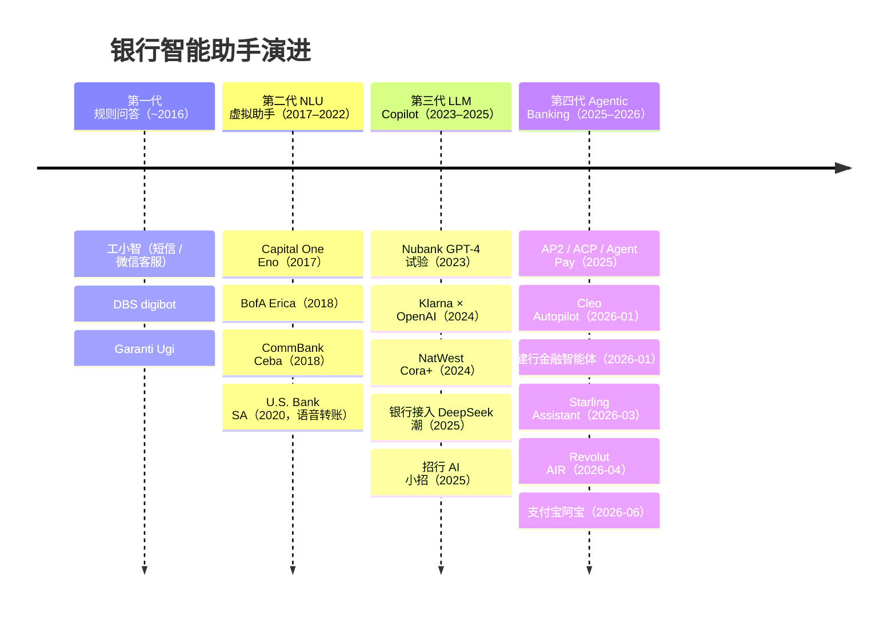
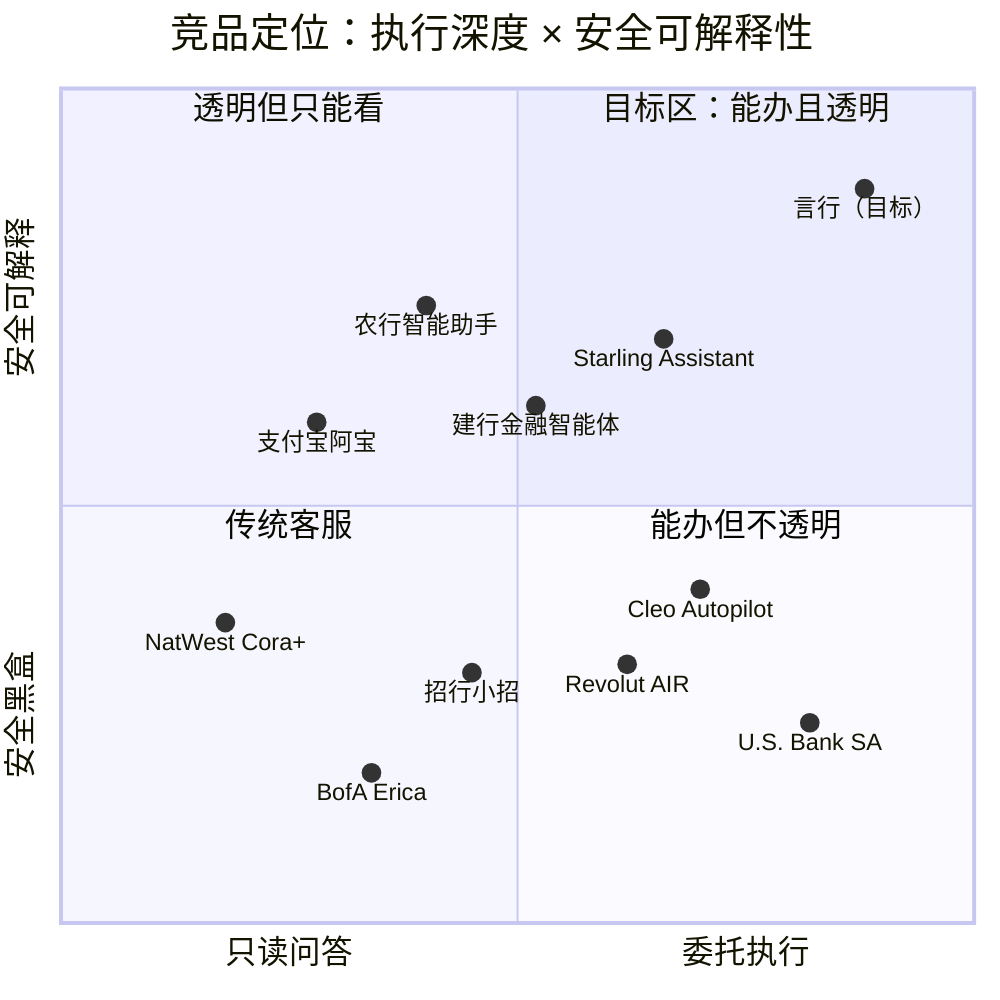

# AI 银行智能体 · 竞品调研报告（横向 + 纵向对比）

| 项目 | 内容 |
|---|---|
| 版本 / 日期 | v1.0 · 2026-10-28（资料截至当日） |
| 调研范围 | 海外 21 款、国内 20 款 AI 银行 / 金融助手；4 类代理支付基础设施 |
| 原始材料 | [A-海外竞品调研](research/A-海外竞品调研.md)（58 条来源）· [B-国内竞品调研](research/B-国内竞品调研.md)（57 条来源） |
| 引用约定 | `A[n]` 指 A 报告第 n 条来源；`B[Sn]` 指 B 报告来源 Sn |

> **口径说明**：只统计**AI 助手本身**公开证实的能力。银行 App 原有菜单功能、员工内部工具和受控试点都不算面客能力。矩阵里的「?」表示公开证据不足，**不等于产品没有该功能**。

---

## 一、结论先行

1. **行业还停在「AI 辅助办理、逐笔确认」阶段，没有一家公开实现可信的「委托式自主执行」。** 海外标杆 Revolut AIR（2026-04 上线）能冻卡、拦截商户扣款、申请虚拟卡，敏感动作需要生物识别；但转账、理财申购、跨场景执行都没有公开证据（A[1–3]）。国内招行、农行、平安能用对话发起转账，前提都是「用户核对后确认」（B[S01–S03]）。
2. **能不能办交易，关键在「可控 API + 认证 + 确认闭环」，而不是用了哪个大模型。** U.S. Bank 2020 年就能用语音发起 Zelle 转账并要求确认，比大模型时代还早（A[17]）。大模型带来的是**理解力**（模糊、隐含意图）和**规划力**（多步任务），执行边界反而更谨慎。
3. **三大空白地带**是比赛的差异化机会：
   - **订阅识别 + 一键取消**：国内只有手动解约入口，海外 AIR 能「拦截扣款」，但做不到商户侧解约（A[2]、B[S10]）。
   - **跨场景长任务**（事件触发 → 预留资金 → 委托采购 → 可撤销）：海内外都没有公开的量产案例。
   - **理财「适当性 → 申购」闭环**：各家只做推荐和诊断，AI 申购没有公开证据。
4. **监管方向明确**：金融监管总局 2026-06《关于银行业保险业人工智能安全开发应用的指导意见》把**资金交易列为高风险 AI 场景**，要求分级管理、人工监督与干预、紧急停用（B[S16]）。这跟赛题的「绿 / 黄 / 红 + 熔断 + 审计」完全对齐，可以作为答辩时的合规背书。
5. **GUI 代操作路线正在被封堵。** 豆包手机助手 2025-12 暂停代操作金融 App；到 2026-10，拒绝屏幕自动化的金融 App 清单在扩大（B[S13][S14]）。**银行授权的工具调用（API / MCP）才是正确路线。**
6. **代理支付已经形成「授权证据链」共识**：Google AP2 的 Intent / Cart Mandate、ACP 的限域支付令牌、Visa / Mastercard 的代理令牌（A[34–38]），都可以直接借鉴为本项目的**委托授权（Mandate）**机制。

---

## 二、横向对比

### 2.1 代表产品多维对比

下表从 41 款产品里选出 10 款最有代表性的，覆盖海外 / 国内、银行 / 金融科技、不同技术路线。

| 产品 | 上线 | 渠道 | 技术路线 | 执行边界 | 安全机制 | 主动服务 | 亮点 | 短板 |
|---|---|---|---|---|---|---|---|---|
| **Revolut AIR**（英、欧） | 2026-04 | App 内对话 | LLM Agent（模型未公开） | 冻卡、卡限额、一次性虚拟卡、暂停周期扣款、拦截商户、买 eSIM | 敏感动作需生物识别；第三方模型零留存 | ? | 对标产品；卡与扣款控制执行能力强 | 转账、理财申购、商户侧解约未证实；入口隐蔽、以文本为主 |
| **U.S. Bank Smart Assistant**（美） | 2020-07 | App、网银，语音 + 文字 | NLU + 银行 API | Zelle 转账、账户间转账、付账、锁 / 解卡 | 口头说「yes」确认；协议明确**语音不是身份认证** | ◐ | 模糊表达追问（「我欠他午餐钱」）；**场景 1 最成熟** | 无理财、无 AA |
| **BofA Erica**（美） | 2018-06 | App，语音 + 文字 | 自研 NLP + 预测分析 | 帮助转账、付账、约见顾问 | 未公开 | ●（累计 17 亿条主动洞察） | 规模最大（5000 万用户）；主动洞察 | 非 LLM Agent；交易边界不透明 |
| **Starling Assistant**（英） | 2026-03 | App，键盘语音 | Gemini + Google Cloud；**模型不接触支付明细** | 创建储蓄 Space、内部划转、安排账单、锁卡 | **每个账户操作都先请求批准**；需主动启用 | ◐ | 「模型转译指令、系统查交易」的隔离架构 | 不能对外付款，无理财 |
| **Cleo Autopilot**（美） | 2026-01 | App，实时语音 | 专用子代理 + 结构化输出 | 储蓄转入、现金预支、商户支出限额 | 每个动作都须同意 | ●（每日计划） | 多步代理 + 记忆 + 日计划 | 非持牌银行；更大的自主执行还在路线图上 |
| **招行零售「小招」** | 2025-02 起 | App，语音 + 文字 | 行内智能服务体系 | 「一语即转」发起转账、按条件选基 | 最终确认方式未完整公开 | ◐ | 转账与财富技能同一入口 | 定时、AA、强认证细节未证实 |
| **建行金融智能体** | 2026-01 | App | 大模型 + 行内 OCR + 风控 | 多轮查询、按风险测评选基、周期转账提醒、确认后转账 | 风险提示、交易确认、人工介入**分级响应** | ◐（预判提醒） | 分级响应理念与赛题最接近 | 对话服务**待备案后**才正式面客 |
| **农行智能助手** | 2025–2026 | App（大字版有语音） | 大模型意图识别 + 调度 | 转账、支付、划转 | **协议写明**：意图识别 → 调度 → 客户核对确认 → 银行执行 | ? | 把 AI 与授权边界写进公开协议 | 场景覆盖面公开信息少 |
| **支付宝「阿宝」**（AI 版支付宝） | 2026-06 邀测 | App 右滑入口 | 蚂蚁百灵模型 + 生态服务 | 生活服务、消费查询 | **资金变动、支付须本人确认** | ◐ | 生态最全；Token Pay / AI 钱包等基础设施 | 不是银行账户，不能办转账理财 |
| **中信「小信 / 阿信」** | 2024–2025 | App、**微信银行** | 大小模型结合的智能体 | 财富咨询、持仓诊断；IM 内只做部分查询 | **高安全业务从 IM 跳转加密页** | ◐ | IM 渠道降权的本土先例 | 交易执行未证实 |

### 2.2 场景能力矩阵（合并精简版）

图例：● 已公开证实完整覆盖 · ◐ 部分 / 只查询 / 试点 · ○ 明确不支持 · ? 未证实

| 产品 | 智能转账 | 账单分析 | 理财操作 | 卡片管理 | 订阅代扣 | 跨场景 | 权限 / 强认证 | IM | 语音 | 主动服务 | 执行交易 |
|---|:-:|:-:|:-:|:-:|:-:|:-:|:-:|:-:|:-:|:-:|:-:|
| Revolut AIR | ? | ● | ◐ | ● | ◐ | ? | ◐ | ? | ? | ? | ◐ |
| U.S. Bank SA | ● | ● | ? | ● | ◐ | ◐ | ◐ | ? | ● | ◐ | ● |
| BofA Erica | ◐ | ● | ◐ | ◐ | ◐ | ? | ? | ? | ● | ● | ◐ |
| Starling Assistant | ◐ | ● | ? | ● | ◐ | ◐ | ◐ | ? | ◐ | ◐ | ◐ |
| Cleo Autopilot | ◐ | ● | ? | ◐ | ◐ | ◐ | ◐ | ? | ● | ● | ◐ |
| Chase Digital Assistant | ◐ | ◐ | ◐ | ● | ? | ? | ? | ? | ? | ? | ◐ |
| Garanti BBVA Ugi | ◐ | ◐ | ◐ | ◐ | ? | ◐ | ? | ◐ | ◐ | ● | ● |
| 招行小招 | ◐ | ◐ | ◐ | ? | ? | ? | ? | ? | ● | ◐ | ◐ |
| 建行金融智能体 | ◐ | ◐ | ◐ | ? | ? | ◐ | ◐ | ? | ◐ | ◐ | ◐ |
| 农行智能助手 | ◐ | ? | ? | ? | ? | ? | ◐ | ? | ◐ | ? | ◐ |
| 平安口袋银行 8.0 | ◐ | ? | ? | ? | ? | ? | ? | ? | ● | ? | ◐ |
| 中信小信 / 阿信 | ? | ◐ | ◐ | ? | ? | ? | ◐ | ● | ● | ◐ | ? |
| 支付宝阿宝 / 蚂小财 | ? | ◐ | ◐ | ○ | ◐ | ◐ | ◐ | ? | ◐ | ◐ | ◐ |
| **言行（本项目目标）** | **●** | **●** | **●** | **●** | **●** | **●** | **●** | **◐** | **◐** | **●** | **●** |

> 完整矩阵（41 款产品）见 [A §五](research/A-海外竞品调研.md) 和 [B §六](research/B-国内竞品调研.md)。

**读表要点**
- **账单分析、卡片管理**最普遍，是行业的「基本盘」。
- **理财执行、订阅商户侧取消、跨场景链路**几乎全是「?」，属于行业空白。
- **「每步都确认」是行业共识**：Starling、Cleo、农行、阿宝都明确要求逐笔批准。区别在于有没有**按风险分级**；只有建行公开提到分级响应。

### 2.3 实现路线对比

| 路线 | 代表 | 原理 | 优点 | 缺点 | 本项目取舍 |
|---|---|---|---|---|---|
| ① NLU + 银行 API | Erica、Eno、U.S. Bank SA、Ceba | 预定义意图 + 槽位 + 后端接口 | 稳定、可控、可审计 | 只能处理预设说法，泛化差，不会规划 | 保留规则快速通道，处理控制指令和高频短句 |
| ② LLM 问答 + 系统检索 | Starling Spending Intelligence、NatWest Cora+ | LLM 理解问题，银行系统查数据，模型不接触明细 | 隐私好，幻觉少 | 只能「看」，不能「办」 | 借鉴「模型不碰原始数据」的隔离思想 |
| ③ **LLM Agent + 工具 + 逐笔批准** | Revolut AIR、Starling Assistant、Cleo | LLM 规划，调用受控工具，敏感动作由用户批准或生物识别 | 能办事，理解力强 | 一律逐笔确认，摩擦大；跨场景能力弱 | **主路线**，并加上风险分级降低摩擦 |
| ④ GUI 识屏代操作 | 智谱 AutoGLM、豆包手机助手 | 读屏、模拟点击 | 不需要 API，通用 | 脆弱，授权与回执无法证明；**被金融 App 封堵** | **不采用** |
| ⑤ 系统意图框架 + 银行合作 | 华为小艺 × 宁波银行 | OS 识别意图，跳转银行 App 内的服务 | 语音直达，银行保留认证 | 依赖设备和系统版本 | 借鉴「多入口，认证回到银行受控界面」 |
| ⑥ 代理支付协议 | Google AP2、OpenAI ACP、Visa / Mastercard | 用可验证的委托书限定代理权限（商户、金额、时间） | 授权有边界、不可抵赖 | 生态早期，多为受控试点 | **借鉴 Mandate 实现跨场景委托执行** |

**结论**：本项目采用 **③ 作为主干，融入 ② 的数据隔离、⑥ 的委托授权、⑤ 的渠道降权，并保留 ① 的规则快速通道**；明确放弃 ④。

---

## 三、纵向对比

### 3.1 时间维度：银行智能助手的四代演进

| 代际 | 核心技术 | 能做什么 | 交互 | 安全模式 | 局限 |
|---|---|---|---|---|---|
| 一代 · 规则问答 | 关键词 / FAQ 匹配 | 回答常见问题 | 单轮 | 不涉及交易 | 答非所问 |
| 二代 · NLU 助手 | 意图分类 + 槽位填充 | 查询 + 少量预定义交易（转账、锁卡） | 有限多轮 | 确认 + 已登录会话 | 只认预设说法，不会规划 |
| 三代 · LLM Copilot | 大模型 + RAG | 自由问答、消费洞察、理财解释 | 自然多轮 | 多数**只读**，刻意不碰交易 | 「能说不能办」；幻觉风险 |
| 四代 · Agentic | 大模型 + 工具调用 + 规划 | 多步任务、有限执行、主动建议 | 对话 + 卡片 | **逐笔批准 / 生物识别**；监管要求分级与人工干预 | 摩擦大；跨场景、委托执行几乎空白 |
| **下一代（本项目瞄准）** | Agent + 策略引擎 + 委托协议 | 按风险分级执行；**按授权在边界内自主执行** | 对话 + 卡片 + 主动推送 | **风险分级 + 所见即所签 + 委托边界 + 全链路审计** | — |

**演进规律**
1. **执行能力并不随模型变强而线性增长。** 二代产品早已能转账；三代因为幻觉风险刻意退回只读；四代靠「确认 + 认证」把执行能力加回来。**安全架构才是执行能力的天花板。**
2. **安全模式的演进**：会话登录 → 逐笔确认 → 生物识别批准 → （下一步）**风险分级 + 委托边界**。逐笔确认安全但累人，委托边界在安全和便利之间取得平衡。
3. **监管同步收紧**：2026 年金融监管总局和上海金融监管局相继发文，对高风险 AI 场景要求报告、人工干预、紧急停用（B[S16][S56]）。

### 3.2 能力深度维度：场景成熟度分级

定义 **L1–L5 成熟度**，评估每个场景在业内公开证实的**最高水平**：

| 等级 | 名称 | 含义 | 举例 |
|---|---|---|---|
| L1 | 问答导航 | 告诉你怎么办、跳到哪个页面 | 「转账在首页第二个按钮」 |
| L2 | 查询洞察 | 帮你看数据、给建议 | 「上个月餐饮花了 2300」 |
| L3 | 确认执行 | 单步业务，确认后替你办 | 「给妈妈转 500」→ 确认 → 完成 |
| L4 | 多步编排 | 一句话拆成多步，可中断、可回退 | 「AA 昨晚的饭钱并提醒他们」 |
| L5 | 主动委托 | 主动发现需求，在授权边界内自动执行 | 生日前自动锁钱、订花，可撤销 |

| 场景 | 海外最佳 | 国内最佳 | 行业空白 | **本项目目标** |
|---|---|---|---|---|
| 智能转账 | **L3**（U.S. Bank：语音 Zelle + 确认） | **L3**（招行一语即转、农行确认执行） | AA 收款、定时委托、反诈联动 | **L4–L5**（AA、定时委托、风险分级） |
| 账单分析 | **L2+**（Erica 主动洞察、Starling） | L2（建行多轮查询、交行看明细） | 自由分析、可解释异常 | **L2+**（沙箱自由分析 + 可解释异常 + 主动预警） |
| 理财操作 | L2（Erica / AIR 展示投资信息） | L2（招行选基、中信诊断） | **AI 申购闭环** | **L3**（适当性 → 风险揭示 → 强认证申购） |
| 卡片管理 | **L3**（AIR 冻卡 / 限额 / 虚拟卡、Chase 锁卡） | L1–?（公开证据少） | 风险不对称处理 | **L3**（收紧低门槛、放松强验证） |
| 订阅代扣 | L3−（AIR 暂停扣款、拦截商户） | L1（手动解约入口） | **自动识别 + 商户侧取消** | **L3–L5**（识别 → 提醒 → 一键取消） |
| 跨场景联动 | L2–L3（Starling 储蓄目标 + 账单、Cleo 日计划） | L2（邮储待办日历、建行预判提醒） | **事件 → 预留 → 委托 → 执行 → 撤销** | **L5**（Mandate 委托执行） |

> 坐标根据公开资料定性估计，仅用于说明定位，不是精确测量。

---

## 四、对本项目的启示

### 4.1 必须做到（行业基本盘）

| # | 启示 | 依据 |
|---|---|---|
| 1 | **确认卡展示完整要素**：实名掩码、尾号、金额、手续费、备注、时间、日累计；重名必须消歧 | U.S. Bank 追问 + 确认闭环（A[17]）；农行协议（B[S02]） |
| 2 | **定级在模型之外**：策略引擎按操作、金额、日累计判级，模型只提计划 | 监管指导意见（B[S16]）；Starling 隔离架构（A[26]） |
| 3 | **敏感动作强认证**，并且认证与交易内容绑定 | AIR 生物识别（A[3]）；PSD2 动态关联 |
| 4 | **可转人工**，出错可暂停 | AIR、Ceba、Klarna 都支持转人工 |
| 5 | **数据最小化**：模型不直接接触明细，由系统检索 | Starling（A[27]）；AIR 第三方零留存（A[3]） |

### 4.2 差异化突破（行业空白）

| # | 突破点 | 竞品现状 | 我们的做法 |
|---|---|---|---|
| 1 | **风险分级降摩擦** | 竞品要么逐笔确认（累），要么不透明 | 绿色零打扰、黄色一次确认、红色强验证，**动态上浮、只升不降** |
| 2 | **委托式跨场景执行** | 无公开案例 | 借鉴 AP2 Mandate：有边界的授权 + 定时触发 + 越界重新确认 + 可撤销 |
| 3 | **订阅全闭环** | 只有手动入口或拦截扣款 | 自动识别（含置信度）→ 续费提醒 → 一键取消（区分停止代扣和商户解约）→ 回执 |
| 4 | **理财合规闭环** | 只推荐不交易 | 「信息卡 → 适当性 → 对比卡 → 申购确认卡 → 强认证」，超风险等级直接拦截 |
| 5 | **可视化 DAG + 中断回退** | 竞品不披露跨业务回退 | 计划卡实时展示每步状态；Saga 补偿回退 |
| 6 | **安全透明化** | 厂商只报交互量，不报误执行率 | 审计回放 + 红队测试报告 + 公开指标（绕过率、幻觉率、误拦截率） |
| 7 | **反诈融入任务链** | 邮储守护人、农行视频核验各自独立 | 话术识别 → 风险上浮 → 冷静期 → 延时到账 → 转人工 |
| 8 | **多渠道共享任务，不共享权限** | 中信 IM 跳转加密页 | 一个任务 ID 贯穿 App / IM / 语音；IM 只办绿黄，红色回 App |

### 4.3 要避免的坑

- **把「导航到页面」当成「办成了」**：演示里要区分「计划成功」「交易已提交」「银行回执成功」三种状态（B 启示 10）。
- **把一句「我爱人生日」当成无限授权**：委托必须有金额、商户、时间边界（B 启示 8）。
- **主动服务过度打扰**：推送要有触发证据、置信度，并且可以关闭（A 启示 8）。
- **把语音当身份认证**：U.S. Bank 协议明确，语音只是输入，不是认证（A[18]）。
- **依赖 GUI 代操作**：金融 App 正在封堵这类做法，评委也会质疑合规性。

---

## 五、对产品定义的输入

这份调研直接决定了 PRD 的几处关键设计：

| PRD 设计 | 来源 |
|---|---|
| 六条设计原则中的「AI 只建议，规则来把关」「所见即所签」 | 2.3 路线对比；4.1 第 2、3 条 |
| 卡片管理的「不对称处理」 | AIR、Chase 的卡控能力 + 风险分级理念 |
| 委托授权（Mandate）与心愿罐 | AP2 Intent Mandate；Starling 储蓄 Space |
| IM 渠道降权 | 中信微信银行跳转加密页 |
| 反诈融入任务链 | 邮储守护人、农行高风险视频核验 |
| 演示脚本中的「攻击演示」与「审计回放」 | 4.2 第 6 条：安全透明化 |
