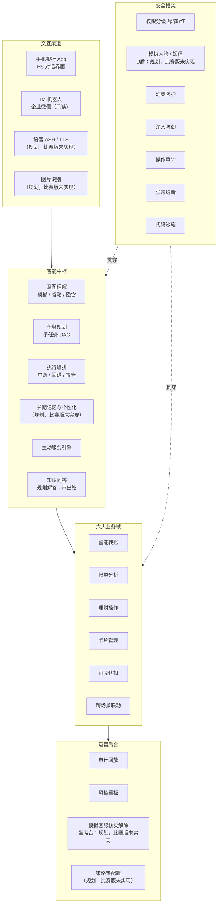

# 「言行」AI 银行智能体 · 产品需求文档（PRD）

| 项目 | 内容 |
|---|---|
| 产品名称 | 言行 SayDo Agent（中文名「言行」，代码仓库 `saydo-agent`） |
| 产品口号 | 言出即办，行必有据 |
| 文档版本 | 同步 main `4a9b3fc`，2026-11-01 |
| 日期 | 2026-11-01 |
| 适用范围 | 「银行 AI 智能体」赛题参赛作品 |
| 关联文档 | [00-竞品调研报告](00-竞品调研报告.md) · [02-产品技术文档](02-产品技术文档.md) · [research/ 原始调研](research/) |

> **比赛版本**：同步 main `4a9b3fc`，2026-11-01。模拟环境只有Ⅰ类借记卡主账户（尾号 6688）有付款账本，暂不支持用绑定进来的他行卡付款。

---

## 1. 背景与问题

### 1.1 赛题背景
传统手机银行操作路径长、功能入口深，完成一笔转账平均需要 3 步以上。以典型流程为例：打开 App → 登录 → 找到转账入口 → 选择收款人 → 输入金额 → 确认 → 验证，实际点击往往有 6~8 次。订阅代扣、交易限额这类低频功能，一般藏在三四层菜单里。

多模态大模型和 Agent 技术成熟以后，「说话就能办业务」开始可以落地，但银行场景有两个硬约束：
1. **错不起**：资金操作不可逆，大模型的幻觉和误解直接变成资金损失。
2. **骗不得**：Agent 会成为新的攻击面，包括提示词注入、借 AI 之手实施电信诈骗、越权操作。

### 1.2 要解决的核心问题

| # | 问题 | 现状 | 我们的解法 |
|---|---|---|---|
| 1 | 操作路径长 | 6~8 次点击，多级菜单 | 一句话描述，Agent 规划执行；绿色操作 1 轮完成 |
| 2 | 服务被动 | 用户找功能，银行不主动 | 事件驱动的主动服务，例如订阅续费提醒、生日联动 |
| 3 | 财务认知弱 | 账单只有流水，看不出问题 | 自动分类、异常识别，用可解释的账单报告告诉用户「钱去哪了」 |
| 4 | AI 不可信 | 大模型会编造、会被诱导 | 「AI 只建议，规则来把关」：权限分级 + 强认证 + 全链路审计 |

### 1.3 产品目标

| 维度 | 目标 | 衡量方式 |
|---|---|---|
| 场景覆盖 | 赛题 6 个场景全部覆盖，其中 3 个做深 | 功能清单验收 |
| 效率 | 绿色操作 1 轮、黄色 2 轮、红色 3 轮内完成 | 场景测试集平均轮数 |
| 准确 | 意图识别准确率 ≥ 95%，任务成功率 ≥ 90% | 自建评测集（≥300 条） |
| 安全 | 红色操作绕过率 = 0；交易结果幻觉率 = 0；关键操作审计覆盖率 = 100% | 红队攻击测试集（≥100 条）+ 审计核对 |
| 体验 | 目标：查询首字 < 1.5s、端到端 < 4s；需要模型的轮次尚未达标 | 以测试报告 §6 服务端实测为准；未测浏览器首字 / 完整用户耗时 |

---

## 2. 用户画像与核心场景

比赛版聚焦小林、陈姐、风控 / 审计员，演示以陈姐的家庭财务任务为主线；王叔需要的语音与适老化为（规划，比赛版未实现）。

| 画像 | 特征 | 高频需求 | 关键痛点 | 设计要点 |
|---|---|---|---|---|
| **小林**（26，互联网职员） | 移动支付重度用户，订阅多，聚餐多 | AA 收款、账单分析、订阅管理 | 不知道钱花哪了，忘记取消试用会员 | 账单报告要「有梗」，AA 一句话发起 |
| **陈姐**（38，家庭财务管理者） | 定期给父母转生活费，关注稳健理财 | 定时转账、理财推荐、家庭纪念日 | 重复操作繁琐，理财产品看不懂 | 定时转账 + 委托授权，产品对比卡 |
| **王叔**（65，退休教师） | 不熟悉复杂操作，偏好语音，容易被诈骗盯上 | 语音查余额、给子女转账 | 怕按错，怕被骗 | 适老化模式、语音、强化反诈 |
| **风控/审计员**（内部用户） | 银行运营人员 | 审计回放、风险处置、人工接管 | AI 决策是黑盒 | 决策链路可回放、可接管、可一键熔断 |

---

## 3. 竞品结论摘要

> 详见 [00-竞品调研报告](00-竞品调研报告.md)（覆盖海外 21 款、国内 20 款产品）。

**公开资料结论（调研截至 2026-10-28，本次未重新调研）**
- **本次资料中主要产品以「AI 辅助办理、逐笔确认」为主。** 对标产品 Revolut AIR（2026-04 上线）能冻卡、拦截商户扣款、申请虚拟卡，敏感动作需生物识别；转账、理财申购、跨场景执行都没有公开证据。国内招行、农行、平安能用对话发起转账，但都要求「用户核对后确认」。
- **执行能力的天花板是安全架构，不是模型。** U.S. Bank 2020 年就能语音转账；大模型带来的是理解力和规划力。
- **监管已经定调。** 金融监管总局 2026-06《指导意见》把资金交易列为高风险 AI 场景，要求分级管理、人工干预、紧急停用，跟赛题的三级权限、熔断、审计完全对齐。
- **GUI 代操作路线正在被封堵**（豆包暂停代操作金融 App，拒绝屏幕自动化的金融 App 清单在扩大）。银行授权的工具调用才是正确路线。

**公开证据较少的能力与本项目取舍**

| 能力 | 竞品最高水平 | 言行的做法 |
|---|---|---|
| 逐笔确认摩擦大 | 一律逐笔确认 | 绿 / 黄 / 红分级 + 动态上浮，低风险零打扰 |
| 跨场景长任务 | 本次资料未见完整案例 | 借鉴 Google AP2 的 Mandate：有边界的委托授权 + 定时执行 + 越界重新确认 |
| 订阅识别 + 取消 | AIR 只能拦截扣款；国内只有手动解约入口 | 自动识别 → 提醒 → 停止本行代扣并给回执；商户侧给取消指引 |
| AI 理财申购 | 只推荐、不交易 | 适当性硬过滤 → 风险揭示 → 强认证申购 |
| 安全不透明 | 厂商只报交互量 | DAG 可视化、审计回放、公开红队指标 |

---

## 4. 产品定位与设计原则

**一句话定位**：一个「会办事、守规矩、懂你」的手机银行 AI 管家。用户说一句话就能办业务；每一步都在可验证、可追溯的安全框架里执行。

**六条设计原则**

| # | 原则 | 含义 | 落地体现 |
|---|---|---|---|
| 1 | **说话就能办** | 对话是入口，卡片是确认 | 自然语言发起，关键信息用结构化卡片展示，不靠大段文字 |
| 2 | **AI 只建议，规则来把关** | 大模型负责理解和规划，没有执行权 | 风险等级由确定性策略引擎计算，大模型无法降级 |
| 3 | **摩擦与风险成正比** | 低风险零打扰，高风险多验证 | 绿 / 黄 / 红三级权限 + 动态风险上浮 |
| 4 | **所见即所签** | 用户确认的内容就是实际执行的内容 | 确认卡由系统按真实参数生成，验证码绑定交易摘要 |
| 5 | **行必有据** | 每个结论和每次执行都有出处 | 数字只能来自工具结果；规则解答必须引用知识库原文；全链路审计可回放 |
| 6 | **主动但不越界** | 主动发现机会，但执行前必须获得授权 | 主动服务一律先提议，执行走委托授权 |

---

## 5. 功能架构总览

下图含目标设计；标注「规划，比赛版未实现」的节点不计入交付，逐项状态见 §6。



**优先级定义**：P0 = 比赛必须演示；P1 = 应该完成，体现完整度；P2 = 加分项，时间允许再做。

---

## 6. 功能需求

> **比赛版状态**：✅ 已实现（按该行描述的比赛范围）· ◐ 部分实现（差异写在该行）· — （规划，比赛版未实现）。P0 / P1 / P2 表示原设计优先级，不等同于完成状态。

> 每个功能点标注 **默认权限等级**（🟢 绿 / 🟡 黄 / 🔴 红）。实际等级由策略引擎按 §7.2 的规则动态计算，**只升不降**。

**赛题需求与比赛版本能力对照**（详细需求与优先级见下文，未实现的规划项不计入已交付能力）

| 赛题场景 | 已实现能力与本次补充 |
|---|---|
| 智能转账 | 称呼 / 手机号、备注、澄清、累计升级、定时转账；支付协议与免密逐笔确认，授权有效期 30 / 90 / 180 / 365 天可选 |
| 账单分析 | 分类、异常、月报、年度报告；年报 12 个月柱状图和同比，「今年以来」按完整月份；商品筛选缺数据时说明原因 |
| 理财操作 | 本人风险测评、适当性硬过滤、推荐 / 对比 / 持仓、申购与赎回 |
| 卡片管理 | 查询、锁卡 / 解锁 / 挂失、限额收紧 / 放宽、虚拟卡、绑卡 / 解绑；熔断仍可止损 |
| 订阅代扣 | 自动识别、总览、续费提醒、停止本行代扣及商户取消指引，不把停代扣说成解约 |
| 跨场景联动 | 赛题第 6 项原句生成「先存 1000 到爱人生日罐，再订花和蛋糕」5 步计划；扩展至未来日期 + 8 类商品、已有罐付款与管理 |

### 6.1 场景一：智能转账

| ID | 功能 | 描述 | 默认等级 | 优先级 | 比赛版 |
|---|---|---|---|---|---|
| F-TR-01 | 按姓名/称呼转账 | 「给我妈转 500」：从联系人别名库解析「我妈」；匹配到多个候选时追问澄清 | 🟡/🔴 按日累计 | P0 | ✅ |
| F-TR-02 | 按手机号转账 | 「给 138xxxx5678 转 200」：查询手机号绑定的账户，展示脱敏户名（如「*明」）让用户核对 | 🟡/🔴 | P0 | ✅ |
| F-TR-03 | 备注转账 | 「给房东转 3500，备注 11 月房租」 | 同上 | P0 | ✅ |
| F-TR-04 | 历史复用 | （规划，比赛版未实现）按历史交易回填金额、收款人、备注；现有多轮指代不等于历史复用 | 同上 | P1 | — |
| F-TR-05 | 定时 / 周期转账 | 创建时按单次金额与收款人风险定级、确认并完成所需验证，之后到期按授权执行；执行前重校验余额、累计、收款人与协议，风险高于原授权转重新确认；支持月初 / 月底和取消。提前一天推送、跳过单期和直接修改金额 / 收款人为（规划，比赛版未实现），修改需取消后重建 | 创建时按金额 🟡/🔴 | P0 | ◐ |
| F-TR-06 | AA 拆分收款 | 按整数分拆分，默认本人计入人数、余数逐分分配；可选本人承担尾差，生成模拟收款邀请并查询已发送 / 已付清。关联账单、部分支付 / 拒绝 / 过期状态跟踪为（规划，比赛版未实现） | 🟡 | P0 | ◐ |
| F-TR-07 | 延时到账与撤销 | （规划，比赛版未实现）新收款人大额延时到账及窗口期撤销；现有冷静期只限制确认时机 | 撤销 🟡 | P1 | — |
| F-TR-08 | 反诈识别 | 对话命中「安全账户 / 刷单 / 保证金 / 公检法」等话术，或出现「新收款人 + 大额 + 催促」的组合时，升到红色，强制弹出反诈提示和冷静期 | 升至 🔴 | P0 | ✅ |
| F-TR-09 | 转账结果与回单 | 结果和回单只按核心系统的回执渲染，不经过大模型改写 | 🟢 | P0 | ✅ |

**日累计规则**：按用户汇总带 `moves_money` 的已用和待确认预占（转账 / 商户付款 / 理财申购），再加本笔金额：≤ 1000 元为 🟡，> 1000 元为 🔴。自然日与滚动 24 小时分别累计；免密有效且适用时只豁免指定额度规则，拆单和频率规则仍独立生效。

**示例对话（F-TR-01 + 省略补全）**
```
用户：给我妈转 500，备注生活费
言行：[确认卡] 向 王*英（工商银行 尾号 1234）转账 ¥500.00（伍佰元整）
      备注：生活费 ｜ 今日已转 ¥0 → 转后累计 ¥500 ｜ 🟡 需要你确认
      [确认转账] [修改] [取消]
用户：（点击确认）
言行：[回单卡] 转账成功，流水号 TX20261028xxxx，预计实时到账。
用户：再给我爸也转一样的
言行：[确认卡] 向 李*国 转账 ¥500.00，备注：生活费 ｜ 转后累计 ¥1,000 ｜ 🟡
用户：再给我妹转 200
言行：[确认卡] 本笔将使今日累计达到 ¥1,200，超过 ¥1,000 → 🔴 需要强验证（小额只因额度超限，人脸、短信任选一种）
```

**验收标准**
- 「我妈 / 老妈 / 母亲」等不同称呼都能解析到同一联系人；重名时必须澄清，不能猜。
- 中文金额（「两千五」「1.5w」「五百块」）解析准确率 100%（测试集 ≥ 50 条）；**有歧义的金额一律回显确认**，不猜测。
- 跨过累计阈值的那一笔必须触发 🔴，测试覆盖「多笔拆单」场景。
- 确认卡上的收款人、金额、备注，与实际执行参数逐字段一致（自动化测试校验）。

### 6.2 场景二：账单分析

| ID | 功能 | 描述 | 默认等级 | 优先级 | 比赛版 |
|---|---|---|---|---|---|
| F-BA-01 | 余额查询 | 「我还有多少钱」：返回所有账户余额汇总 | 🟢 | P0 | ✅ |
| F-BA-02 | 交易查询 | 「上个月在美团花了多少」「最近一笔超过 1000 的消费」：用自然语言组合筛选条件；无商品级明细时，「上个月买鞋花了多少」说明无法准确筛选，不用全部消费冒充结果 | 🟢 | P0 | ✅ |
| F-BA-03 | 消费分类统计 | 按「餐饮 / 交通 / 购物 / 娱乐 / 居住 / 订阅…」统计，输出饼图和环比 | 🟢 | P0 | ✅ |
| F-BA-04 | 异常交易识别 | 近 90 天商户 / 类别基线、金额偏离、深夜、境外、新商户、高频及重复扣款；每条附实际命中原因，不宣称已确认盗刷；无城市轨迹识别或反馈学习 | 🟢 | P0 | ✅ |
| F-BA-05 | 月度 / 年度报告 | 支持「2025年账单报告」「去年全年收支」「今年以来」（按已过完整月份）；年报含 12 个月收支柱状图和同比，报告卡片包含收支、分类占比、Top 商户、订阅总额、储蓄率、异常事件；文字解读由大模型生成，**其中的数字一律来自计算结果并经过校验** | 🟢 | P0 | ✅ |
| F-BA-06 | 自由分析 | 「过去半年周末点外卖比工作日多花多少」：大模型生成分析代码，**在沙箱中运行**，只读脱敏数据 | 🟢 | P1 | ✅ |
| F-BA-07 | 分类纠正 | （规划，比赛版未实现）用户更正类别并推广到后续同类交易 | 🟢 | P1 | — |
| F-BA-08 | 预算提醒 | （规划，比赛版未实现）消费预算及超出 80% 提醒；计划付款缺款提醒另见 F-XS-07 | 🟢 | P2 | — |

**隐含意图示例**：「这个月钱怎么花得这么快？」→ 本月与上月的分类对比，加上异常交易和增长最快的类别。

**验收标准**
- 报告里的每个数字都能在工具输出中找到出处，测试中数字幻觉为 0。
- 异常识别对预埋的 10 类异常样本召回率 ≥ 90%，正常交易误报率 ≤ 5%。
- 历史种子覆盖 2024-01-01 至 2025-12-31；2024 年收入 229,295.23 元、消费 125,543.38 元，2025 年收入 241,037.61 元、消费 127,842.37 元，同比收入 +5.1%、消费 +1.8%；月度合计与年报一致，2026 流水和当前余额不变。

### 6.3 场景三：理财操作

| ID | 功能 | 描述 | 默认等级 | 优先级 | 比赛版 |
|---|---|---|---|---|---|
| F-WM-01 | 风险测评 | 以固定问卷卡片的形式呈现，**用户逐题选择作答，Agent 不代填、不从聊天内容推断答案**；得出 C1–C5，结果经用户确认后生效，有效期 12 个月 | 🟡；可购范围提升时 🔴 | P0 | ✅ |
| F-WM-02 | 产品推荐 | 只推荐风险等级（R1–R5）≤ 客户等级的产品，同时说明推荐理由和风险；不承诺收益 | 🟢 | P0 | ✅ |
| F-WM-03 | 产品对比 | 「A 和 B 哪个好」：用对比卡展示收益、风险、期限、流动性、费率，结论中立 | 🟢 | P0 | ✅ |
| F-WM-04 | 持仓与收益查询 | 「我的理财这个月赚了多少」 | 🟢 | P0 | ✅ |
| F-WM-05 | 收益试算 | （规划，比赛版未实现）按本金、期限计算情景收益；当前产品详情的历史净值展示不等同于试算工具 | 🟢 | P1 | — |
| F-WM-06 | 一键申购 | 依次经过适当性校验、风险揭示、确认卡、强认证；产品风险超出客户等级时**直接拦截** | 🔴 | P0 | ✅ |
| F-WM-07 | 赎回 | 赎回到本人账户，展示到账时间和费用；有提前赎回费，或会亏损赎回时，上浮为 🔴 | 🟡/🔴 | P1 | ✅ |
| F-WM-08 | 闲钱规划 | 可按期限与风险等级推荐单个产品；组合配置、备用金与资金分配为（规划，比赛版未实现） | 🟢 | P2 | ◐ |

**合规要求**：推荐话术里不得出现「保本」「稳赚」等字眼；每个推荐都附风险提示；所有推荐记录进入审计，满足可回溯要求。

**条款问答**：「能提前赎回吗」「手续费多少」这类条款问题，由知识库回答并附出处（F-GN-14）；产品的风险等级和可售状态只取产品主数据，不从说明书文本里读取。

### 6.4 场景四：卡片管理

> 设计亮点是**不对称处理**：**收紧保护的操作门槛低，放松保护的操作门槛高**。用户说「卡丢了」，能立刻锁卡止损；解锁则必须强验证。

| ID | 功能 | 描述 | 默认等级 | 优先级 | 比赛版 |
|---|---|---|---|---|---|
| F-CD-01 | 卡片查询 | 卡列表、状态、额度、限额 | 🟢 | P0 | ✅ |
| F-CD-02 | 虚拟卡申请 | 模拟申请虚拟卡并设置限额；一次性销毁、单商户专用绑定为（规划，比赛版未实现） | 🟡 | P0 | ◐ |
| F-CD-03 | 临时锁卡 | 「我卡好像丢了」：识别隐含意图后先建议锁卡，用户确认即生效，可逆 | 🟡 | P0 | ✅ |
| F-CD-04 | 解锁 | 解除临时锁定 | 🔴 | P0 | ✅ |
| F-CD-05 | 挂失 / 解挂 | 模拟正式挂失、解除挂失，均需强验证；补卡为（规划，比赛版未实现） | 🔴 | P0 | ◐ |
| F-CD-06 | 交易限制 · 收紧 | 关闭境外、线上或 ATM 交易，调低单笔 / 单日限额 | 🟡 | P0 | ✅ |
| F-CD-07 | 交易限制 · 放宽 | 开启境外交易、调高限额 | 🔴 | P0 | ✅ |
| F-CD-08 | 信用额度调整 | （规划，比赛版未实现）信用额度调低 / 临时 / 永久提额；当前交易限额收紧与放宽见 F-CD-06 / 07 | 🟡/🔴 | P1 | — |
| F-CD-09 | 密码修改 | （规划，比赛版未实现）安全键盘改密；比赛版不接收银行卡密码，应引导柜台或人工 | 🔴 | P1 | — |
| F-CD-10 | 实体卡申请 | （规划，比赛版未实现）申请新实体卡与卡面选择；模拟绑定已有他行卡见 F-CD-11 | 🟡 | P2 | — |
| F-CD-11 | 绑定 / 解绑银行卡 | 模拟卡池绑定、查看详情和完整卡号、解绑及归属 / 状态重校验；只有主账户 6688 可付款，绑卡不产生付款账本 | 绑定 / 解绑 🔴 | P0 | ✅ |

### 6.5 场景五：订阅 / 代扣管理

| ID | 功能 | 描述 | 默认等级 | 优先级 | 比赛版 |
|---|---|---|---|---|---|
| F-SB-01 | 订阅自动识别 | 从流水中识别周期性扣费（同一商户、金额接近、间隔规律），给出置信度 | 🟢 | P0 | ✅ |
| F-SB-02 | 订阅总览 | 「我每个月订阅花多少」：列出所有订阅、月度和年化总额、下次扣费日 | 🟢 | P0 | ✅ |
| F-SB-03 | 续费提醒 | 支持未来扣费查询和周期提前量提醒、涨价及余额不足提示；提前量辅助函数尚未接主动调度；独立推送服务与完整试用转正识别为（规划，比赛版未实现） | 🟢 查询（主动推送未接） | P0 | ◐ |
| F-SB-04 | 停止代扣与取消指引 | 确认后停止本行代扣并给回执；仅商户侧或无本行协议时给知识库取消指引。未实现商户取消 API / 异步回执，不能把停止代扣称为「已解约」 | 🟡 | P0 | ◐ |
| F-SB-05 | 重复订阅建议 | （规划，比赛版未实现）重复会员识别和合并建议 | 🟢 | P2 | — |
| F-SB-06 | 订阅绑定虚拟卡 | （规划，比赛版未实现）把新订阅关联到限额虚拟卡 | 🟡 | P2 | — |

### 6.6 场景六：跨场景联动

**标杆用例（赛题第 6 项原句）**：「我爱人11月20号生日，当月锁定1000元活期，生日前2天订鲜花和蛋糕」。生成 5 步：存 1000 元进「爱人生日」心愿罐 → 鲜花询价 → 从罐下单鲜花 → 蛋糕询价 → 从罐下单蛋糕；先确认并验证存款，再等临期，11-18 10:00 下单、11-20 送达。


| ID | 功能 | 描述 | 默认等级 | 优先级 | 比赛版 |
|---|---|---|---|---|---|
| F-XS-01 | 重要日期识别 | 从当前请求识别生日 / 纪念日、保存到计划并按日期执行；独立日期记忆、查看 / 删除记忆为（规划，比赛版未实现） | 🟢 | P0 | ◐ |
| F-XS-02 | 心愿罐 / 资金锁定 | 从活期划转到专项子账户；「心愿罐 / 打开心愿罐 / 我的心愿罐」直达管理卡，显示余额、已支出、待执行计划，提供转入 / 转出 / 明细 / 新建；带金额的单步存入直接出确认卡；部分转出不得动用计划预占金额 | 存入 🔴（仅本规则人脸或短信任选，无 1,000 元免验证线）；转出 🟡；查询 🟢 | P0 | ✅ |
| F-XS-03 | 临期一键确认（**默认模式**） | 生日前 2 天的演示扫描询价并备好订单（商品、商户、总价、配送时间、退款条件），用户确认后付款；无独立后台调度或移动推送 | 🟡（白名单商户 + 心愿罐资金 + 日累计 ≤ 1000），否则 🔴 | P0 | ✅ |
| F-XS-04 | 通用定时购物计划 | 未来日期 + 商城 8 类（鲜花、蛋糕、鞋服、数码、日用、图书、礼品卡、家电）生成待执行计划；普通日期当天 10:00 下单，确认计划授权卡内商品、金额上限与来源内的 🟡 到期付款，风险升高重新确认；生日 / 纪念日提前 2 天下单、当天送达且仍逐笔确认订单 | 计划内到期付款 🟡；风险上浮 🔴 | P0 | ✅ |
| F-XS-05 | 联动模板库 | （规划，比赛版未实现）工资到账自动转定期 / 还信用卡、旅行自动开关境外交易等；种子自动配平不是用户联动模板 | 按动作定级 | P1 | — |
| F-XS-06 | 计划管理 | 查看计划、继续、重新规划、取消 / 逆序补偿、转人工暂停写操作；直接暂停 / 恢复全部预约和通用规则编辑为（规划，比赛版未实现） | 🟢/🟡 | P0 | ◐ |
| F-XS-07 | 计划资金保障 | 活期计划按预算上限合计提议存罐；执行前 24 小时内缺款提醒一次，到期不足转待补款；补足后继续并重询价 / 校验，变化转确认，过原送达日不付款 | 查询 🟢；存入 🔴；付款按策略 | P0 | ✅ |
| F-XS-08 | 开放商品识别与计划兜底 | 未来购物从动词后取宾语，按中心词映射类目、优先匹配同名商品；缺货如实说明并列出可买类目，模糊商品追问；问句 / 提醒 / 送人去医院不触发下单。模型计划校验失败整份丢弃，审计 `plan_rejected`（`fallback=rule`），规则按原话重建并再校验；普通对话未来询价整组拦截，审计 `future_shopping_blocked` | 不授予付款权，仍按计划 / 订单授权 | P0 | ✅ |

**设计要点**
- **两类授权分开**：生日 / 纪念日仍临期逐笔确认；普通日期购物在计划卡上预览商品、对象、预算上限、付款来源与配送信息，确认计划即授权这些边界内的到期付款，风险升高重新确认。存入心愿罐始终单独确认、验证。
- **锁定计划预算**：活期付款计划可点「先存入心愿罐锁定预算」，或说「锁定预算 / 先把预算存进心愿罐」；按计划内活期订单的预算上限合计出存入确认卡（🔴，人脸或短信任选），成功后新版本计划卡显示「已改为从心愿罐「…」付款」。
- **计划资金保障**：执行前 24 小时内预检活期或罐余额，不足提醒一次，足够不打扰；到期不足的步骤转「待补款」（`awaiting_funds`），计划保持进行中。补足后说「继续」或点「补款后继续」，重新询价同款，金额 / 配送 / 风险变化转确认卡；超过原送达日标为「已过期」，不再付款。
- **绑定已有罐**：「用心愿罐里的钱」先调用只读 `pot.select`；多罐不明确先追问，没有罐或余额不足时提示存入金额与用途，不自动改用活期。
- 状态更新通过操作后同步 / 演示快进显示；可通过取消订单、回退计划或管理卡释放心愿罐，不是独立移动推送。

### 6.7 通用智能能力

| ID | 功能 | 描述 | 优先级 | 比赛版 |
|---|---|---|---|---|
| F-GN-01 | 模糊表达理解 | 缺金额时追问；规则覆盖固定说法，模型处理开放说法。「老样子」按长期历史习惯自动补全为（规划，比赛版未实现） | P0 | ◐ |
| F-GN-02 | 省略与指代 | 「那上个月呢？」「再给他转一笔」：结合多轮上下文补全意图和槽位 | P0 | ✅ |
| F-GN-03 | 隐含意图 | 「卡好像丢了」→ 锁卡；「钱怎么花这么快」→ 账单分析；「下个月老婆生日」→ 联动提议 | P0 | ✅ |
| F-GN-04 | 澄清策略 | 同名收款人、多罐 / 卡片等用选择卡，缺金额 / 商品等用文字追问；不承诺所有澄清都为最多 3 项选择题 | P0 | ✅ |
| F-GN-05 | 任务 DAG 可视化 | 复杂任务先展示「执行计划卡」，列出步骤、依赖、各步风险等级，实时更新状态 | P0 | ✅ |
| F-GN-06 | 中断 | 支持取消待确认动作、修改金额、计划取消及重新规划；执行中的请求完成后再处理后续控制语，不提供并发抢占 | P0 | ✅ |
| F-GN-07 | 回退 | 计划按逆序追加取消订单 / 退款、释放心愿罐的补偿提议，补偿仍走确认；转账不可回退，不支持通用虚拟卡补偿 | P0 | ✅ |
| F-GN-08 | 人工接管 | 支持用户要求转人工、计划暂停写操作、熔断后模拟客服核实解除；自动因连续误解 / 负面情绪转接、坐席工作台和接管包为（规划，比赛版未实现） | P0 | ◐ |
| F-GN-09 | 多渠道 | H5 与企业微信长连接。企业微信只读；所有需要确认的操作（🟡 / 🔴）均引导回 App。演示身份按配置自动绑定，OAuth 银行身份绑定为（规划，比赛版未实现） | P1 | ✅ |
| F-GN-10 | 语音 | （规划，比赛版未实现）语音输入与播报 | P1 | — |
| F-GN-11 | 图片理解 | （规划，比赛版未实现）账单 / 截图识别，图片文字视为不可信数据 | P2 | — |
| F-GN-12 | 长期记忆管理 | （规划，比赛版未实现）偏好、日期的同意 / 查看 / 修改 / 删除；联系人与亲密关系用主数据管理，不以自由文本记忆提升信任 | P1 | — |
| F-GN-13 | 适老化模式 | （规划，比赛版未实现）大字、慢语速、复述与更严格反诈 | P2 | — |
| F-GN-14 | 知识问答 | 「稳健 90 能提前赎回吗」「跨行转账多久到账」「信用卡挂失要钱吗」：从知识库检索产品说明和业务规则作答，**每条结论附出处**（文档 · 条款 · 版本 · 生效日期）；没查到就如实说明，并提供转人工入口 | P1 | ✅ |

**F-GN-14 知识问答的边界**

一句话：知识库回答「规则是什么」，工具回答「你的账户是什么」。三条红线：
1. 余额、交易、持仓、额度只来自工具查询，**不从知识库回答**。
2. 风险等级和权限判定只来自策略引擎，**检索到的文本不能影响权限**。
3. 收款人和别名只来自收款人主数据。

同一个问题既涉及规则又涉及账户时，回复分别标注「知识来源」和「数据来源」。例如「我现在赎回会亏吗？」：赎回规则引用产品说明书条款，当前盈亏取自持仓查询。

**验收标准**
- 50 题问答集：检索命中率（Hit@5）≥ 90%，引用正确率 ≥ 95%。
- 超出知识库范围的问题，拒答率 ≥ 90%；知识类数字（费率、天数）幻觉为 0。
- 「我余额多少」这类问题 100% 走工具，不走知识库。
- 知识库文档里预埋的指令文本，不会触发任何工具调用。

### 6.8 支付协议、免密授权与联系人

本节四项已在比赛版本中实现，纳入功能与验收范围（同步 main `4a9b3fc`，2026-11-01）。

| ID | 功能 | 需求与验收要点 | 权限 | 比赛版 |
|---|---|---|---|---|
| F-PY-01 | 支付服务协议 | 首次转账、商户付款、创建定时转账授权或存入心愿罐时，按需出《支付服务协议》卡；同意后接着出原交易确认卡，无需重述。不同意则取消；未签署时确认接口兜底拒绝 | 签协议不代替逐笔确认 / 验证 | ✅ |
| F-PY-02 | 免密支付授权 | 用户选默认付款卡，用万 / 千 / 百 / 十 / 个五列滚轮设置单笔和每日额度；单笔最高 2,000 元、每日最高 5,000 元，均须大于 0，且单笔不高于每日。只对已验证亲密关系的联系人（父母 / 伴侣 / 子女 / 兄弟姐妹 / 密友）及合作商户生效，有效期 30 / 90 / 180 / 365 天可选（默认 365 天），点金额才弹五位滚轮小窗，表单可取消 | 开通、任一额度调高、换卡或延长到期日 🔴 人脸 + 短信；只调低、缩短到期日、关闭 🟡 | ✅ |
| F-PY-03 | 联系人管理卡 | 增删改姓名、卡号、开户行、手机号、称呼；删除为软删除，有未执行定时转账时先取消任务。称呼与已验证亲密关系分开维护，不能只凭「妈妈」称呼获得免密资格 | 增删改、解除关系 🟡；绑定关系 🔴，人脸或短信任选一种 | ✅ |
| F-PY-04 | 心愿罐管理与明细 | 「心愿罐 / 打开心愿罐 / 我的心愿罐」直达管理卡，显示余额、已支出、待执行计划，提供转入 / 转出 / 明细 / 新建；部分转出到活期保留罐，不得占用计划预留金额；内部划转不计转出累计、不占免密额度。明细含存入、付款、退款、部分转出及释放退回，多个罐先澄清 | 存入 🔴（人脸或短信任选，注入风险两项）；转出 / 释放 🟡；查明细 🟢；存入须先签协议 | ✅ |

**免密边界**：额度内免验证不免确认，每笔仍出 🟡 确认卡；超过单笔、每日任一额度或使用非默认卡，升 🔴。新收款人、频繁转账、拆单、反诈、注入规则及银行硬限额均不豁免；非亲密联系人、非合作商户按原规则定级。免密只豁免指定额度规则（技术文档 §5.2），其余风险仍只升不降；心愿罐向商户付款沿用原规则，不使用银行卡免密额度。

**入口与来源**：首次符合条件的支付成功后，回执下方附免密邀请卡，「暂不开通」后 30 天不再主动邀请；也可说「开通免密支付」。模型只能出授权表单，服务端只认本轮用户原话的办理意图，外部内容不能触发，模型不能预填额度；付款卡与额度由用户在表单选择、填写。联系人卡号、手机号只能来自用户本轮原话或表单，确认卡与审计只显示尾号 / 打码。

**失效要求**：授权 ID 与版本绑定进动作摘要；撤销、到期、额度或付款卡变更、解除关系、删除联系人、确认时可用额度不足，都会使已出的免密确认卡失去执行资格，须重新发起。改联系人卡号时清除首次转账标记及亲密关系，下一笔按新收款人处理；删除后重新添加必须重新绑定亲密关系。有成功转账历史的同一卡号可恢复已有收款人标记，但不恢复亲密关系。绑定关系始终提供短信替代人脸，不以人脸作为唯一方式（沿用 §7.3 的要求）。

**用户故事**

- 作为首次付款用户，我希望先读懂并同意规则，再继续刚才的交易。
- 作为常给家人转账的用户，我希望亲自设定付款卡和额度，在额度内核对并确认即可付款。
- 作为联系人管理者，我希望修改或解除关系后立即收回免密资格，旧确认卡不能继续使用。
- 作为心愿罐用户，我希望随时查清每笔存入、付款和退回，余额与实际账务一致。

---

## 7. 安全需求

### 7.1 权限分级矩阵

> 依据 [research/D §五](research/D-安全合规调研.md) 的操作-风险矩阵，并结合赛题要求校准。**1000 元是赛题设定的原型阈值，不是银行法定的强验证线**。银行实际约束（账户类别限额、个人非柜面单日累计超过 5 万元须用数字证书 / 电子签名，即银发〔2016〕261 号）在工具层另外校验，不能互相替代。

**等级定义**

| 等级 | 执行策略 |
|---|---|
| 🟢 **绿色** | 已授权会话内的纯查询，没有外部副作用；意图确认后**自动执行** |
| 🟡 **黄色** | 展示由后端生成的**确认卡**，用户对本次动作明确确认后执行 |
| 🔴 **红色** | 确认卡 + 按规则验证；一般双因子，小额额度类 / 存罐 / 关系绑定可任选一种（§7.3）；均为模拟 |
| ⛔ **禁止** | Agent 不受理，引导到柜台或人工 |

**操作级矩阵（比赛已实现范围）**

| 场景 | 操作 | 等级 | 条件与边界 |
|---|---|---|---|
| 查询 | 余额、账单、卡片、订阅、持仓、知识、罐明细 | 🟢 | 需进入凭证 / 渠道身份；查看完整卡号另做模拟人脸 |
| 转账 | 已有收款人、累计额度内 | 🟡 | 无其他风险；有效免密仅豁免指定额度规则，不免逐笔确认 |
| 转账 | 自然日 / 滚动 24 小时累计超 1000、新收款人、频率、拆单、反诈、注入 | 🔴 或阻断 | 原型阈值；不同命中规则决定任选一种或双因子；5 万元硬限额直接阻断 |
| 定时转账 | 创建 / 取消 | 按单次金额 + 收款人风险 / 🟡 | 创建完成确认和所需验证；到期重新定级，高于原授权则重新确认；修改需取消重建 |
| AA | 发起模拟收款 / 查看 | 🟡 / 🟢 | 拆分按分计算，不会替其他人付款 |
| 理财 | 本人提交问卷、重测等级提高 | 🟡 / 🔴 | 用户逐题点选，模型不代填 |
| 理财 | 申购 / 赎回 | 🔴 / 🟡～🔴 | 适当性硬过滤；赎回有费用、亏损或达到 5 万元升级 |
| 卡片 | 虚拟卡、锁卡、收紧交易限制 | 🟡 | 锁卡 / 收紧可止损；虚拟卡不属止损 |
| 卡片 | 解锁、挂失 / 解挂、放宽、绑定 / 解绑 | 🔴 | 挂失可在熔断时办，但仍需验证；绑定他行卡不产生付款账本 |
| 订阅 | 停本行代扣 | 🟡 | 止损；只给商户取消指引，不冒充商户已解约 |
| 心愿罐 | 存入 / 部分转出 / 释放 | 🔴 / 🟡 / 🟡 | 存入仅命中 `pot_lock` 时人脸或短信任选，金额不限 1000 元；注入等额外风险两项；转出不得动用计划 / 订单预占；内部划转不占转出 / 免密额度 |
| 商户付款 | 合作商户 + 罐资金 + 当日累计含本笔 ≤ 1000 | 🟡 | 其他情况通常 🔴；活期付款若银行卡免密适用且额度内也可 🟡 |
| 普通日期购物计划 | 确认计划授权卡内商品、金额上限、来源和时间 | 🟡 到期付款 | 到期重新询价 / 定级，风险升高重新确认；生日 / 纪念日仍逐笔确认订单 |
| 免密授权 | 开通 / 提额 / 换卡 / 延期；调低 / 缩短 / 关闭 | 🔴；🟡 | 🔴 人脸 + 短信；仅主账户 6688 付款；免验证不免确认 |
| 联系人 | 增删改 / 解除关系；绑定关系 | 🟡；🔴 | 绑定仅命中本规则时人脸或短信任选；改卡号清除已有信任，旧卡重校验 |

报告外分享、理财定投、撤销申购、补卡 / 改密码 / 提授信额度、新开商户自动续费、设备 / 地理位置风控、长期不定额代购为（规划，比赛版未实现），不纳入上表。当前不开放注销账户、改绑预留手机或替他人支付 AA。

### 7.2 动态风险上浮规则（只升不降）

| 因子 | 当前实现 | 处理 |
|---|---|---|
| 金额累计 | `cumulative_outflow` / `rolling_24h_outflow` 仅作用于 `transfer.create`，自然日或滚动 24 小时 > 1000；自然日余额与硬限额另含 `moves_money` 工具成功 / 预占 | 🔴；免密适用时仅豁免配置的额度规则 |
| 新收款人 | 没有成功转账历史，任意金额 | 🔴；称呼 / 关系不替代转账历史 |
| 拆单 | 同账号 1 小时内前面已有 ≥ 2 笔小额，本笔也是 ≤ 1000，合计 > 1000 | 🔴；未实现跨行关联账户识别 |
| 频率 | 5 分钟内第 3 笔转账起（按动作 / 流水口径） | 🔴；资金已确认第 5 笔的熔断另行计数 |
| 反诈 | 规则话术，或新收款人 + 大额 + 催促组合 | 🔴 + 30 秒冷静期；模型不决定诈骗评分；无延时到账实现 |
| 注入 | 当前输入可疑则写动作 🔴；高置信 1 次会话只读，1 小时计数类 3 次转人工 | 分级处理，不是所有可疑输入立即只读；外部备注隔离不累加用户熔断 |
| 渠道 | 企业微信只读 | 任何需要确认的动作均回 App，包含 🟡 与 🔴 |
| 状态变化 | 账户 / 余额 / 关系 / 授权版本 / 产品 / 协议重校验 | 硬约束不满足、关键绑定失效或等级升高即作废；同为 🔴 的验证强度变化更新挑战 |

> 限制提示要说明原因类别、影响范围、恢复方式和申诉渠道。新设备、异地、夜间自动上浮与跨会话反诈复核为（规划，比赛版未实现）。

### 7.3 强认证方式

| 因子 | 类别 | 比赛中的实现 | 适用场景 |
|---|---|---|---|
| 人脸识别 | 生物特征 | 按钮模拟，不调摄像头、不采集图像；不是真实身份认证 | 所有 🔴 |
| 短信验证码 | 持有物 | 模拟短信面板；**验证码与交易摘要绑定**（金额 + 收款人哈希），改了参数验证码就失效 | 所有 🔴 |
| U盾 | 持有物（强） | （规划，比赛版未实现）WebAuthn / Passkey；当前没有 U盾接口 | 单笔 > 5 万、改密码等 |

规则：
- 🔴 默认需要人脸 + 短信两种模拟因子；小额额度类、存罐、关系绑定的例外见下文。短信 + U盾为（规划，比赛版未实现）。
- **小额分级（v0.3，10-31）**：只因额度规则升到 🔴（当日累计超 1000 元、跨零点 24 小时累计、非合作商户 / 不从心愿罐付款的订单、免密超额），且单笔 ≤ 1000 元、当日累计 ≤ 5000 元时，人脸、短信**任选一种**即可（默认人脸，可改用短信）。用户已在进入 App 时做过人脸核身、又在确认卡上逐项确认；小额再叠加两步验证体验过重。新收款人、5 分钟内频繁转账、注入 / 诈骗嫌疑、拆单、卡片放宽 / 解锁 / 挂失 / 绑卡、理财，以及单笔或累计更大的，仍要两种都过。确认前累计涨过上限时自动改回两种都要。
- **心愿罐存入**：`pot.lock` 基础 🔴；只命中 `pot_lock` 时人脸、短信任选一种，注入等额外风险叠加时两项都要。部分转出 `pot.withdraw` 基础 🟡，确认和执行前均检查余额及计划预占。
- **人脸不能是唯一的验证方式**（《人脸识别技术应用安全管理办法》第十条）：任选一种时始终提供短信作为替代，并且原型不保存人脸图像。
- 单因子场景是比赛原型的体验取舍，不能作为生产强认证达标结论；短信可能被截获，进入核身也仅为模拟。
- 同一意图认证连续失败 3 次触发熔断（见 S-04）。

> **表述边界**：比赛的人脸和短信为模拟；U盾 / WebAuthn 为（规划，比赛版未实现）。不宣称接入真实认证服务。

### 7.4 五大安全机制需求

| ID | 机制 | 需求描述 | 验收标准 |
|---|---|---|---|
| S-01 | **幻觉防护** | 账户和交易信息只能来自工具返回的结果；交易结果由系统回执渲染；大模型生成的文本要做数字与事实校验，校验不通过就重新生成或降级为模板 | 评测集中数字 / 交易结果幻觉 = 0 |
| S-02 | **注入防御** | 多层防御：输入检测、权限与模型分离、不可信数据隔离（转账备注、商户名、IM 消息、图片文字）、参数来源校验、确认卡兜底；比赛版加载知识条目时扫描注入；双人审核和版本发布流程为（规划，比赛版未实现），检索内容只作参考，不能触发操作 | 红队测试集（≥100 条，含间接注入）中 🔴 操作绕过 = 0 |
| S-03 | **操作审计** | 每次请求记录完整决策链：原始输入、意图、计划 DAG、风险评估、认证、工具调用、结果、回复；哈希链可检测日志篡改（比赛版未设数据库只追加约束和外部锚点），可以在后台回放 | 关键操作审计覆盖 100%；篡改可被检测 |
| S-04 | **异常熔断** | 按各条件独立触发会话只读、工具 / 资金暂停或转人工；不是必须逐级升级，不是真实银行账户冻结；后台提供全局「只读开关」 | 各熔断条件均有自动化测试 |
| S-05 | **沙箱环境** | 大模型生成的代码在隔离环境运行：无网络、只读的脱敏数据快照、CPU / 内存 / 时间限制、禁止危险模块；执行过程全程记录 | 逃逸测试用例（读文件、联网、fork 炸弹等）全部被拦截 |

### 7.5 隐私与数据保护
- **敏感信息不进模型**：密码、验证码、完整卡号、身份证号不会出现在大模型上下文中，进入前由脱敏层替换成占位符。
- **最小必要**：每个任务只把相关数据交给模型，例如账单分析只传汇总结果。
- **AI 内容标识**：大模型生成的内容在界面上标注「AI 生成」。
- **记忆可控**：长期记忆同意 / 查看 / 删除为（规划，比赛版未实现）；当前只有会话上下文和结构化联系人。
- **不用于训练**：姓名、身份证号、手机号、银行卡号等个人信息，不得用于模型训练或优化（金发〔2026〕8 号第（二十四）项）。

### 7.6 合规定位

| 事项 | 要求 | 依据 |
|---|---|---|
| 产品定位 | 定位为**银行自营渠道内**的智能体，不是第三方理财销售方；外部 Agent 通过 MCP 接入时，不能做适当性测评、申购或产品互动咨询 | 《金融产品网络营销管理办法》（八部门公告〔2026〕第 9 号）第二十条 |
| 演示环境 | 全部使用**合成数据**，与任何真实支付通道隔离；页面常驻「演示环境」标识；回执带「模拟回执」水印；人脸 / 短信标注为「模拟验证」；U盾未实现 | 风险 R13（research/D） |
| AI 内容标识 | 对话中 AI 生成的文字标注「AI 生成」；**交易回单由交易系统签发**，不能用生成文本冒充回单 | 《人工智能生成合成内容标识办法》 |
| 高风险治理 | 资金交易类 AI 属于高风险应用：设置人工监督、干预和**紧急停用**（全局只读开关）；关键决策保留原始数据、推理路径和阈值记录 | 金发〔2026〕8 号第（十六）、（十七）、（二十二）项 |
| 理财话术 | 不承诺保本或收益；只展示适当性范围内的产品；推荐过程可回溯 | 《商业银行理财业务监督管理办法》第二十六条；金融监管总局令〔2025〕7 号 |
| 自动续费 | 续费前显著提醒、可以随时简便取消 | 《消费者权益保护法实施条例》第十条 |

---

## 8. 非功能需求

| 类别 | 要求 |
|---|---|
| 性能 | 目标：查询首字 < 1.5s、端到端 < 4s（尚未全面达到）；固定流程毫秒级，模型轮次历史均值 8.2 秒，回归集整体 3.9 秒，详见测试报告 §6；当前非流式，计划在操作后同步 / 演示快进扫描时更新 |
| 可用性 | 大模型服务不可用时，自动降级为「快捷菜单 + 模板」；模型可以热切换 |
| 可观测 | 每次对话都有 trace，覆盖模型调用、工具调用、耗时和 token |
| 可部署 | `make demo` / 双击启动；SQLite 与合成数据；Docker Compose 为（规划，比赛版未实现） |
| 可测试 | pytest 单元 / 场景 / 红队、Playwright 端到端；真实模型评测独立运行，不把假模型通过等同真实模型完成率 |
| 兼容性 | 移动端 H5（iOS / Android 浏览器），PC 端模拟手机框展示 |
| 可访问性 | （规划，比赛版未实现）适老化模式、字号切换、语音 |

---

## 9. 交互设计要点

### 9.1 卡片体系

| 卡片 | 用途 | 关键字段 |
|---|---|---|
| 信息卡 | 余额、交易、持仓 | 数据 + 出处时间戳 |
| 知识卡 | 产品条款、业务规则问答 | 答案 + 出处（文档 · 条款 · 版本 · 生效日期）；同时涉及账户数据时，分开标注「知识来源」和「数据来源」 |
| **确认卡** | 🟡 / 🔴 操作 | 操作类型、对象（脱敏户名 + 尾号）、金额（大小写）、备注、当日累计、风险等级、有效期（2 分钟）、[确认] [修改] [取消] |
| 认证卡 | 🔴 强认证 | 交易摘要、所需因子、进度 |
| **计划卡** | DAG 任务 | 步骤、依赖、状态；定时购物列商品、对象、金额上限、付款来源、执行和配送时间；普通日期确认计划即授权 🟡 到期付款；活期计划可锁定预算，缺款步骤显示「待补款」及「补款后继续」 |
| 报告卡 | 月度 / 年度账单 | 分类图；年报 12 个月收支柱状图与同比，数字来自代码计算 |
| 心愿罐管理卡 | 「我的心愿罐」 | 余额、已支出、待执行计划；转入 / 转出 / 明细 / 新建，转出不占计划预留 |
| 对比卡 | 理财对比 | 多列对比 + 风险提示 |
| 风险提示卡 | 反诈 / 异常 | 风险原因、建议动作、冷静期倒计时 |
| 回单卡 | 执行结果 | 系统回执原文：流水号、时间、状态 |

### 9.2 话术规范
- 金额复述同时给出阿拉伯数字和中文大写。
- 失败时说明原因和下一步，**绝不把失败说成成功**。
- 不确定就问，不猜测；澄清用选择题。
- 理财类话术合规：不承诺收益，必须附风险提示。

### 9.3 页面结构

比赛版：单个 H5 对话页、卡片 / 弹层、设置和运营后台（审计 / 熔断 / 模拟客服）。下列独立页面、坐席台、策略编辑、知识库审核及记忆管理为（规划，比赛版未实现）。
- **用户端（H5）**：对话首页（含快捷指令）· 账户 · 计划与授权 · 消息 · 我的（记忆管理、安全设置、适老化开关）
- **运营后台**：审计回放 · 风控看板（熔断事件、拦截统计）· 人工接管台 · 策略配置（阈值、规则开关）· 知识库管理（编写、双人审核、版本、检索评测）

---

## 10. 数据指标

| 类型 | 指标 |
|---|---|
| 北极星 | **一句话办结率**：一轮对话发起并成功完成的任务占比 |
| 效率 | 平均交互轮数、平均完成时长、相比传统 App 节省的步数 |
| 质量 | 意图准确率、槽位 F1、任务成功率、澄清率；知识问答的引用正确率、超范围拒答率 |
| 安全 | 🔴 绕过率、幻觉率、注入拦截率、误拦截率、熔断触发次数 |
| 主动服务 | 提醒采纳率、委托执行成功率 |

---

## 11. 版本规划与演示策略

### 11.1 迭代计划（以 6 周为例，按实际赛程调整）

> 比赛赛程、冻结安排与交付进度统一见 [03-开发计划](03-开发计划.md)。下表保留完整版本路线，含已实现项与（规划，比赛版未实现）项；各功能当前状态只以 §6 为准。

| 阶段 | 周期 | 范围 | 里程碑 |
|---|---|---|---|
| M0 基础 | 第 1 周 | Mock 核心银行 + 种子数据、Agent 主循环、策略引擎、确认卡 | 能跑通「查余额」「小额转账」 |
| M1 核心 | 第 2–3 周 | 转账全功能、账单分析 + 报告、卡片管理、强认证、审计、熔断；安全样本库、意图示例库 | 3 个场景 + 完整安全框架 |
| M2 完整 | 第 4 周 | 理财、订阅、跨场景联动、DAG 计划卡、中断 / 回退 / 接管、沙箱；知识库（产品说明、规则 FAQ、商户取消指引） | 6 个场景全覆盖 |
| M3 加分 | 第 5 周 | IM 渠道、语音、运营后台、红队测试集 | 多渠道演示 |
| M4 交付 | 第 6 周 | 测评报告、安全自评报告、PPT、演示视频、README | 提交 |

### 11.2 演示策略

以「陈姐给妈妈过生日」为一条用户故事，串起查账、订阅整理、家庭转账、计划采购与资金保障、风险处置和审计。具体输入、顺序、口播与时间轴只维护在 [09-演示视频脚本](09-演示视频脚本.md)；答辩按评分项组织的材料见 [08-PPT大纲](08-PPT大纲.md)。

---

## 12. 风险与依赖

| 风险 | 影响 | 应对 |
|---|---|---|
| 大模型工具调用不稳定 | 任务失败、体验差 | 结构化输出 + 校验重试；关键意图用规则兜底；准备多个模型备选 |
| 演示时网络或 API 故障 | 演示中断 | 录制备用视频；支持确定性规则降级（本地小模型为规划，比赛版未实现） |
| 范围过大做不完 | 交付质量差 | 严格按 P0 → P1 → P2 推进，P0 先做透 |
| 合规表述不当 | 扣分 | 理财话术合规审查；数据全部为模拟数据并显著标注 |
| 知识库内容出错或过期 | 回答了错误的规则 | 当前加载扫描、带出处和版本；双人审核为（规划，比赛版未实现）；没查到就拒答，不用模型常识补充 |

---

## 附录 A：目标意图清单（42 + 7 + 6）

此表保留目标设计标识，不是当前工具注册表，也不代表 55 项均已实现。实现范围按 §6 的比赛版列，实际工具名与统计见技术文档 §5.1。

> 基础清单来自 [research/E §8](research/E-核心算法与场景实现调研.md)，补充了 7 个业务意图和 6 个通用控制意图。（括号）内是必填槽位，［方括号］内是可选槽位。等级是默认等级，实际以策略引擎计算为准。

| # | 意图 ID | 说明与槽位 | 默认等级 |
|---|---|---|---|
| **转账** ||||
| 1 | `transfer.by_name` | 按姓名 / 称呼转账（收款人，金额）［备注］ | 🟡/🔴 |
| 2 | `transfer.by_phone` | 按手机号转账（手机号，金额）［姓名］ | 🟡/🔴 |
| 3 | `transfer.with_memo` | 备注转账（收款人，金额，备注） | 🟡/🔴 |
| 4 | `transfer.scheduled` | 定时转账（收款人，金额，执行时间） | 按金额 |
| 5 | `transfer.recurring` | 周期转账（收款人，金额，周期，起始日） | 按单次金额 |
| 6 | `transfer.status` | 查转账状态（订单号） | 🟢 |
| 7 | `transfer.cancel_pending` | 取消还没执行的转账（计划号） | 🟡 |
| 8 | `split.create` | 发起 AA 收款（总额，参与人）［比例］ | 🟡 |
| 9 | `split.status` | 查询 / 催收 AA（收款单号）［参与人］ | 🟢 查 / 🟡 催 |
| **账单** ||||
| 10 | `tx.search` | 查交易（时间范围）［商户 / 金额］ | 🟢 |
| 11 | `bill.category_stats` | 查分类支出（时间范围，类别） | 🟢 |
| 12 | `tx.recategorize` | 更正类别（交易 ID，新类别）［适用范围］ | 🟢 |
| 13 | `bill.anomalies` | 查异常（时间范围） | 🟢 |
| 14 | `anomaly.feedback` | 反馈异常是不是本人（事件 ID，是否本人） | 🟢 |
| 15 | `report.monthly` | 生成月报（年月） | 🟢 |
| 16 | `report.yearly` | 生成年报（年份） | 🟢 |
| **理财** ||||
| 17 | `risk.assess` | 开始 / 更新风险测评（问卷答案） | 🟡 |
| 18 | `risk.level` | 查风险等级 | 🟢 |
| 19 | `wealth.recommend` | 推荐产品（目标，金额，期限） | 🟢 |
| 20 | `wealth.compare` | 对比产品（产品列表） | 🟢 |
| 21 | `wealth.simulate` | 收益试算（产品，本金，期限） | 🟢 |
| 22 | `wealth.purchase` | 申购（产品，金额，付款账户） | 🔴 |
| 23 | `wealth.redeem` | 赎回（持仓，份额）［收款账户］ | 🟡 |
| **卡片** ||||
| 24 | `card.apply` | 申请卡（卡种：虚拟 / 实体） | 🟡 |
| 25 | `card.status` | 查卡状态（卡） | 🟢 |
| 26 | `card.credit_limit` | 调整额度（卡，目标额度） | 调低 🟡 / 调高 🔴 |
| 27 | `card.set_restriction` | 设置交易限制（卡，类型，参数） | 收紧 🟡 / 放宽 🔴 |
| 28 | `card.unlock` | 解锁卡 | 🔴 |
| 29 | `card.temp_lock` | 临时冻结卡 | 🟡 |
| 30 | `card.report_loss` | 挂失卡［是否补卡］ | 🔴 |
| **订阅** ||||
| 31 | `sub.list` | 查订阅（时间范围） | 🟢 |
| 32 | `sub.confirm_cycle` | 确认 / 修正周期（订阅，周期） | 🟢 |
| 33 | `sub.remind_set` | 设置续费提醒（订阅，提前量） | 🟢 |
| 34 | `sub.cancel_billing` | 停止本行代扣 / 免密协议（协议） | 🟡 |
| 35 | `sub.cancel_merchant` | 发起商户侧取消（订阅） | 🟡 |
| 36 | `sub.cancel_status` | 查取消进度（请求 ID） | 🟢 |
| **跨场景联动** ||||
| 37 | `event.remember_date` | 记住重要日期（对象，日期）［历法］；写入记忆前征得同意 | 🟢 |
| 38 | `goal.reserve_funds` | 建立心愿罐 / 资金预留（目标，金额，期限） | 🔴（人脸或短信任选） |
| 39 | `automation.create_rule` | 创建主动规则（触发条件，动作） | 只提醒 🟢 / 涉及动作 🟡 |
| 40 | `mandate.upsert` | 创建 / 修改委托（动作，上限，商户范围，有效期） | 按总额 🟡/🔴 |
| 41 | `mandate.revoke` | 撤销委托（委托 ID） | 🟡 |
| 42 | `task.manage` | 查看 / 中断跨场景任务（任务 ID） | 查 🟢 / 中断 🟡 |
| **补充业务意图** ||||
| 43 | `account.balance` | 余额查询［账户］ | 🟢 |
| 44 | `bill.adhoc_analysis` | 自由分析（问题），在沙箱中执行 | 🟢 |
| 45 | `budget.set` | 设置预算（类别，金额，周期） | 🟢 |
| 46 | `wealth.holdings` | 持仓与收益查询 | 🟢 |
| 47 | `card.cancel_loss` | 解除挂失 | 🔴 |
| 48 | `card.change_pin` | 修改密码（只在安全键盘里输入） | 🔴 |
| 49 | `transfer.repeat_last` | 按上次转账复用（收款人线索） | 🟡/🔴 |
| **通用控制** ||||
| 50 | `control.confirm` / `control.cancel` | 确认 / 取消当前待办 | — |
| 51 | `control.modify` | 修改当前待确认对象（「改成 800」） | — |
| 52 | `control.undo` | 撤销 / 回退已完成的步骤 | 按补偿动作定级 |
| 53 | `control.pause` | 暂停执行（「等一下」） | — |
| 54 | `handoff.human` | 转人工（原因） | — |
| 55 | `chitchat` / `faq` | 闲聊 / 产品知识问答（RAG，带出处，见 F-GN-14） | 🟢 |

## 附录 B：术语表

| 术语 | 说明 |
|---|---|
| DAG | 有向无环图，复杂任务拆成的子任务依赖结构 |
| 委托授权（Mandate） | 用户预先授予 Agent 的、带边界（商户 / 金额 / 时间 / 次数）的执行权限 |
| 所见即所签 | 用户确认和认证的内容与实际执行内容严格一致（对应 PSD2 的 dynamic linking） |
| 日累计 | 自然日内对外转账成功和处理中金额之和 |
| 熔断 | 检测到异常后自动限制 Agent 的执行能力 |
