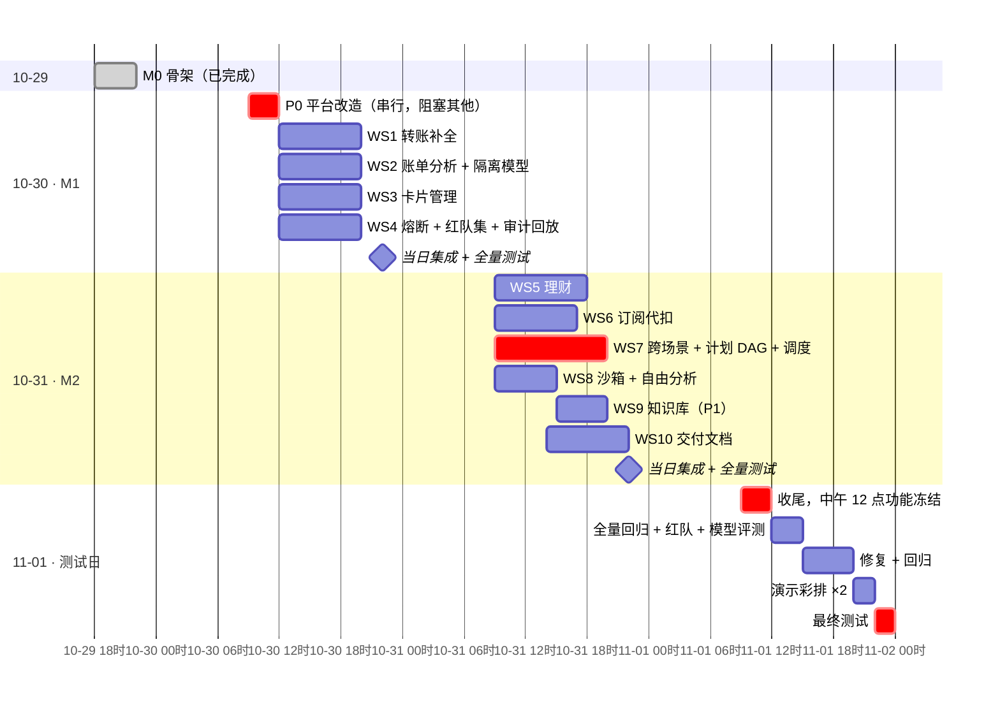

# 「言行」开发计划与任务拆分

| 项目 | 内容 |
|---|---|
| 版本 | v1 · 2026-10-29 |
| 目标 | **2026-11-01 结束前完成最终测试** |
| 赛程 | 11-01 12:00 团队功能冻结 · **11-02 作品提交截止**（具体时刻以官网为准） · 11-10 公布前十强 · **11-28～30 深圳决赛**（原定 11-21～23，因深圳重大会议延期；现场黑客松：专家看作品提意见，团队一两天内修改，最后答辩评前三） |
| 模型 | DeepSeek `deepseek-flash`（V4.1 Flash），API 调用。DeepSeek 密钥到位前先用智谱 `glm-5.3-flash`，`.env` 改 `LLM_PROVIDER` 切换 |
| 关联 | [PRD](01-产品需求文档-PRD.md) · [技术文档](02-产品技术文档.md)（比赛版本的技术调整见 §3.4） |

---

## 1. 原则

1. **每天收尾都是可演示的版本**：当天的新功能合入后，全量测试必须是绿的。
2. **11-01 12:00 功能冻结**，之后只修 bug、只做测试。
3. 按优先级推进：赛题硬要求（6 个场景各有可演示的主链路，5 个安全机制都有实现和测试）> 演示脚本里出现的功能 > 其他 P0 > P1。
4. 新增写操作一律复用 M0 的安全外壳：策略引擎定级 → 确认卡 → 🔴 强验证 → 执行令牌 → 工具网关 → 审计。**不允许绕开这条路径直接改数据。**
5. 每个功能都配测试：规则模式下的端到端测试（不耗 API），关键链路再用真实模型的评测集验证。

## 2. 范围取舍

原计划是 6 周，现在压缩到 3 天。PRD 里的 P0 做不完全部，按下表取舍：

| 场景 | 必做（演示主链路） | 降级处理 | 不做 |
|---|---|---|---|
| 智能转账 | ✅ 按称呼转账、备注、累计升级、新收款人 🔴（M0 已完成）；手机号转账；反诈话术 🔴 + 冷静期；AA 拆分（按分精确拆分） | AA 收款状态只做「已发送 / 已付清」 | 历史复用、延时到账 |
| 账单分析 | 交易查询、分类统计 + 饼图、异常识别、月度 / 年度报告（数字零幻觉，年度 12 个月柱状图与同比，历史种子补 2024–2025）、自由分析（沙箱） | 分类以 MCC 规则为主，模型只兜底 | 分类纠正、预算提醒 |
| 理财操作 | 风险测评问卷、推荐（R ≤ C 硬过滤）、对比、持仓、申购 🔴、赎回 🟡/🔴 | — | 收益试算、闲钱规划 |
| 卡片管理 | 查卡、锁卡 🟡、解锁 🔴、挂失 🔴、收紧限制 🟡、放宽限制 🔴、「卡好像丢了」隐含意图 | 虚拟卡只做「申请 + 限额」 | 额度调整、密码修改、实体卡 |
| 订阅代扣 | 自动识别（带置信度）、总览、续费提醒、取消三种情况 | 商户侧取消用模拟接口 + 异步回执 | 重复订阅建议、绑定虚拟卡 |
| 跨场景联动 | 爱人生日原句：存 1000 进「爱人生日」罐 🔴（人脸或短信任选）→ 临期询价 → 从罐订花和蛋糕；通用未来日期 + 7 类商品计划，普通日期确认计划授权 🟡 到期付款；心愿罐管理卡与部分转出；中断、回退、人工接管；定时转账 | 调度用「时间快进 + 定时扫描」实现 | 长期 / 不定额自动代购、联动模板库 |
| 通用 | 多轮省略补全、澄清、知识问答（P1） | — | IM 渠道、语音、图片、适老化、对外 MCP + OpenClaw 演示 |

> **IM 渠道**需要飞书企业自建应用的凭证和公网回调地址，3 天内风险太高，答辩时只讲架构（渠道降权、🔴 跳回 App）。如果 10-31 晚上还有余力，再做飞书只读查询。

## 3. 每日计划

### 10-29（周四）M0 ✅

- 后端骨架、模拟核心银行（复式记账）与种子数据、策略引擎、确认卡 / 强认证 / 执行令牌、工具网关、审计哈希链、Agent 主循环（DeepSeek + 规则兜底）、手机端对话页。
- 查余额、小额转账两条链路前后端打通；79 个测试通过。

### 10-30（周五）M1：平台改造 + 4 个工作流

**P0 平台改造（上午，串行，其他工作流都依赖它）**

| 任务 | 说明 | 完成标准 |
|---|---|---|
| ✅ 通用待确认动作 | `propose_action` / `create_action`（`auth/actions.py`）；确认卡、验证卡、短信、回执都按 `action_display(...)` 的 `rows` / `summary` 渲染 | 转账测试仍全绿；假的写工具（改昵称）走通确认 → 执行（`tests/test_actions.py`） |
| ✅ 通用策略上下文 | 写工具注册时带 `policy_context` 构造器，公共部分用 `base_context`；规则用 `tool_in` 限定工具、`when` 匹配事实；止损类工具（`stop_loss`）熔断时仍放行 | 规则表驱动测试覆盖（`tests/test_policy.py`） |
| ✅ 前端卡片注册表 | `components/CardHost.vue` 按 `type` 映射 `components/cards/` 下的组件 | — |
| ✅ 提示词能力清单自动生成 | 「你能做的事」和帮助语由工具的 `capability` / `examples` 生成 | — |
| 接入真实模型 | ✅ 先用 GLM 跑通 `make smoke-llm`；✅ 30 句回归集 `make eval-llm`（`apps/api/evals/regression.yaml`） | 回归集意图准确率 ≥ 90% |
| ✅ 版本管理 | `git init`，提交 M0 基线，之后每个工作流一个分支 | — |

**并行工作流**

| 编号 | 工作流 | 范围（PRD 编号） | 主要文件 | 完成标准 |
|---|---|---|---|---|
| WS1 | 转账补全 | F-TR-02 手机号、F-TR-06 AA、F-TR-08 反诈；规则：滚动 24 小时、拆单 | `tools/transfer.py`、`policy/rules.yaml`、`nlu/` | 拆单 / 反诈 / AA 尾差各有测试；反诈话术必定 🔴 + 冷静期 |
| WS2 | 账单分析 | F-BA-02 ~ 05；隔离模型（注入防御 L4）：交易备注、商户名不进主模型 | `tools/bill.py`、`agent/quarantine.py`、`components/ReportCard.vue` | 报告数字 100% 来自计算结果；种子数据里的注入备注不影响任何输出；预埋异常召回 |
| WS3 | 卡片管理 | F-CD-01 ~ 07；「卡丢了」隐含意图；收紧 🟡 / 放宽 🔴 | `tools/card.py`、种子数据加信用卡 | 不对称定级的表驱动测试；熔断时锁卡仍可用 |
| WS4 | 熔断与安全 | 熔断器（认证连败、注入、频率、工具异常 → 只读 / 冻结 / 转人工）；止损白名单；红队测试集 ≥ 100 条；运营后台按 trace 回放 | `security/breaker.py`、`tests/redteam/`、`components/AuditTimeline.vue` | 🔴 绕过 = 0；每个熔断条件有测试；熔断提示说明原因和申诉渠道 |

晚上：合并分支 → 全量测试 → 演示脚本前半段走一遍。

### 10-31（周六）M2：剩余场景 + 跨场景

| 编号 | 工作流 | 范围 | 主要文件 | 完成标准 |
|---|---|---|---|---|
| WS5 | 理财 | 种子产品 6–8 个（R1–R5）；F-WM-01 测评问卷卡（用户逐题选，不代填）、02 推荐、03 对比、04 持仓、06 申购 🔴 + 风险揭示、07 赎回 🟡/🔴 | `tools/wealth.py` | 超出风险等级的产品必被拦截；话术不含「保本」「稳赚」 |
| WS6 | 订阅代扣 | F-SB-01 识别（置信度公式见技术文档 §7.3）、02 总览、03 提醒、04 取消三种情况 | `tools/subscription.py` | 只停代扣时绝不说「已解约」；种子数据里 6 个订阅全部识别 |
| WS7 | 跨场景 + 任务规划 | 计划 DAG（规划器输出 JSON → 校验器：白名单、无环、参数来源）；计划卡；心愿罐；时间快进触发临期任务；模拟花店 / 蛋糕店询价下单；中断、回退（补偿）、人工接管；F-TR-05 定时转账 | `agent/planner.py`、`tools/automation.py`、`components/PlanCard.vue` | 生日用例全程可演示；「蛋糕不要了」能重新规划；「撤销锁定」能释放心愿罐 |
| WS8 | 沙箱 + 自由分析 | F-BA-06：模型生成分析代码 → AST 白名单 → 子进程（CPU / 内存 / 时间限制、禁网络和文件写入、只读脱敏快照） | `sandbox/` | 逃逸测试 ≥ 20 条全部拦截 |
| WS9 | 知识库（P1） | F-GN-14：产品说明 + FAQ + 商户取消指引；`kb.search`；知识卡带出处 | `knowledge/`、`data/kb/` | 50 题评测：命中率 ≥ 90%，超范围拒答 |
| WS10 | 交付文档 | README / 部署说明、架构图导出、测试报告模板、安全自评报告（基于技术文档 §14）、PPT 大纲、演示视频脚本 | `docs/` | 赛题要求的提交物清单逐项有着落 |

WS7 是关键路径，最先开工；WS9 在 WS6 之后做（订阅取消要用商户取消指引）。

晚上：合并 → 全量测试 → 完整演示脚本走一遍。

### 11-01（周日）测试日

| 时间 | 内容 | 通过标准 |
|---|---|---|
| 09:00–12:00 | 收尾当天未完成的 P0；**12:00 功能冻结** | — |
| 12:00–15:00 | 全量回归 | 后端测试全绿；红队集 🔴 绕过 = 0、数字 / 结果幻觉 = 0、正常请求误拦截 ≤ 3%；沙箱逃逸全拦截 |
| | 真实模型评测集（≥ 100 句，覆盖 6 个场景和省略、指代、澄清） | 意图准确率 ≥ 90%，任务成功率 ≥ 85% |
| | 新目录从零安装（按 README） | 一次跑通 |
| 15:00–20:00 | 修复 + 回归 | 每修一个 bug 补一条测试 |
| 20:00–22:00 | 演示彩排 2 遍：真实模型（DeepSeek）1 遍、断网规则模式 1 遍 | 5 分钟内走完；记录卡顿点 |
| 22:00–24:00 | **最终测试**：全量测试再跑一遍，产出测试报告，打 `final-test` 标签 | 全部通过 |

PPT 定稿和演示视频录制放在最终测试之后，按比赛提交截止时间安排（建议 11-02 上午）。

### 调整后的排期（10-30 更新）

M2 的 WS5–WS8 在 10-30 上午提前完成并合入 main（850 个测试全绿，GLM 回归集 130 条 99%）。比赛提交日确定为 **11-02**，11-01 用来收尾。剩余任务：

**10-30（剩余时间）**

| # | 任务 | 谁 |
|---|---|---|
| 1 | 模型密钥配置页：DeepSeek / GLM 二选一，图形化填写，写入 `.env`，不用重启 | 主会话 |
| 2 | WS10 交付文档：README 重写、部署说明、架构图、安全自评（S-01–S-05）、测试报告模板、PPT 大纲、视频脚本 | 独立会话 |
| 3 | `/admin` 口令保护 | 主会话 |
| 4 | 演示脚本对齐实现（生日句式、去掉飞书段落），在浏览器里完整走一遍并当场修 | 主会话 |

**10-31（最后一个开发日）**

| # | 任务 | 谁 |
|---|---|---|
| 5 | 用填好的模型跑冒烟 + 回归集；DeepSeek 和 GLM 哪个有密钥就用哪个，两个都有时两个都跑 | 主会话（密钥由用户在配置页填） |
| 6 | 性能：演示句减少模型调用、常用句走规则；前端「处理中」提示 | 主会话 |
| 7 | 出卡后的回复压到 60 字以内 | 主会话 |
| 8 | WS9 知识库（P1），时间不够就砍 | 独立会话 |
| 9 | 回归集补省略、指代、澄清多轮用例（→ 约 150 条） | 主会话 |
| 10 | 按 README 在新目录从零安装 | 主会话 |
| 11 | 演示脚本 E2E（Playwright），可选 | 主会话 |
| 12 | 飞书只读查询：前面都顺利才做，否则答辩只讲架构 | 可选 |

**11-01（收尾日）**：上午收尾，12:00 功能冻结；下午全量回归 + 红队 + 真实模型回归集，只修 bug；晚上彩排 2 遍（真实模型 1 遍、断网规则模式 1 遍）并录备用视频；最后产出测试报告、打 `final-test` 标签、推送 GitHub。

**11-01 调整记录**：合入免密支付（协议、免密授权、联系人管理、心愿罐明细），合并提交 `3e0c82e`，纳入比赛提交版；后端 1557 个测试、浏览器端到端 22 条全部通过，详见[测试报告](06-测试报告.md)。

**11-01 分支补充（`feat/pot-plans`，代码 `4c05639`，尚未合入 main）**：通用定时购物、已有罐绑定与缺款提示、心愿罐管理 / 部分转出、存罐 🔴 任选验证、年度账单与 2024–2025 历史种子、免密有效期与金额弹窗已完成。后端 1704 / 1704（业务与平台 1399 + 红队 305，157.19 秒）、Playwright 23 / 23 全部通过；真实模型沿用前次记录，本分支未重跑。文档同步后仍需合并、人工按 5 分钟脚本计时与录制。

**11-02（提交日）**：PPT 定稿、录正式演示视频、对照提交清单逐项检查后提交。

明确不做（答辩讲架构）：语音、图片、适老化、长期记忆管理、对外 MCP；飞书视进度而定。

## 4. 并行开发约定

### 4.1 新场景怎么接入

以「锁卡」为例，一个写操作只需要这几步，确认、验证、令牌、网关、审计都不用再写：

1. **写工具**：在 `tools/<领域>.py` 里用 `@bank_tool(..., side_effect=True, llm_visible=False)` 注册执行函数 `fn(db, args, *, idempotency_key, user_id) -> dict`。返回 `status`，回执要多显示的行放在 `receipt_rows`。
   - 动钱的加 `moves_money=True`，`args` 里必须有 `amount_fen`，系统会做余额 / 限额检查并预占额度；
   - 止损类（锁卡、挂失）加 `stop_loss=True`，熔断时仍可执行；
   - 需要特有上下文的写 `policy_context=fn(db, args, env)`，在里面调用 `base_context(db, env, tool=..., facts={...})`，执行前重新校验也用它。
2. **提议工具**：再注册一个模型可见的工具（写好 `description`、`capability`、`examples`），在里面组织 `args`，用 `action_display(title=, verb=, summary=, rows=)` 描述确认卡，然后 `return propose_action(ctx, tool=..., args=..., display=...)`。
3. **规则**：在 `policy/rules.yaml` 末尾追加，例如 `{id: card_loosen, tool_in: [card.limit_set], when: {direction: loosen}, elevate_to: RED, reason: ...}`。
4. **前端**：展示类新卡片在 `components/cards/` 新建组件，并在 `CardHost.vue` 的 `CARDS` 里加一行；确认卡和回执是通用的，不用改。
5. **测试**：规则模式的端到端测试，用 `conftest.py` 里的 `fake` 假模型脚本化工具调用；`evals/regression.yaml` 末尾追加真实模型用例。

### 4.2 协作约定

- **文件归属**：每个工作流新建自己的 `tools/<领域>.py` 和前端组件，尽量不改别人的文件。
- **共享文件只追加**：`models.py`、`core_mock/seed.py`、`policy/rules.yaml` 只在末尾追加，不改已有内容；合并冲突由当天集成的人处理。
- **不改安全外壳**：`auth/actions.py`、`tools/gateway.py`、`audit/` 在 P0 改造之后冻结，需要改动先提出来。
- **测试先行**：每个工作流至少一个规则模式的端到端测试，覆盖它的演示主链路。
- **运行方式**：如果是一个人加 AI，可以用 git worktree 开多个会话并行做同一天的工作流，晚上合并；如果是 4 人团队，按技术文档 §13 的角色认领。

## 5. 风险与待确认

| 事项 | 影响 | 应对 |
|---|---|---|
| 模型二选一 | DeepSeek 和 GLM 的工具调用表现不一定一致 | 两家都支持，在模型配置页任选其一填密钥即可；冻结前用实际要演示的那家重跑冒烟和回归集 |
| 比赛提交日 11-02（具体时刻待确认） | 影响 PPT 和视频的排期 | 11-01 收尾和彩排，11-02 定稿提交；如果 11-02 上午就截止，PPT 和视频挪到 11-01 晚上 |
| 团队人数未知 | 影响并行度 | 一个人时，10-30 / 10-31 各自只能完成 2–3 个工作流，取舍按第 2 节从右往左砍 |
| 模型工具调用不稳定 | 演示翻车 | 规则兜底 + 断网彩排；关键演示句加入回归集 |
| 3 天工期过紧 | 功能做不完 | 严格按第 2 节取舍；12:00 冻结不让步 |
