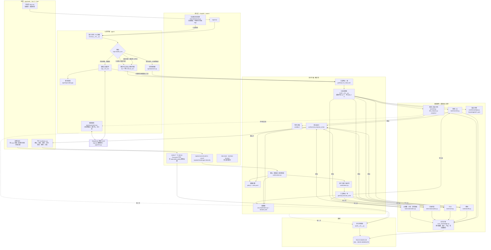
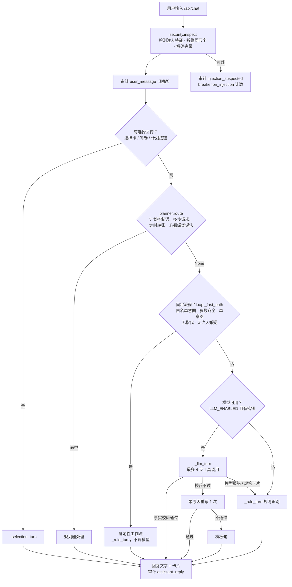
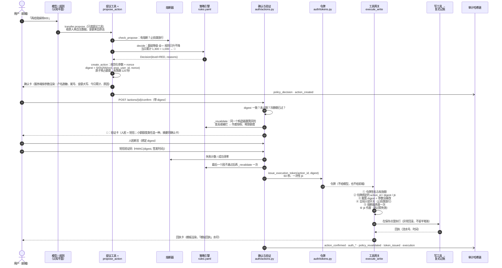
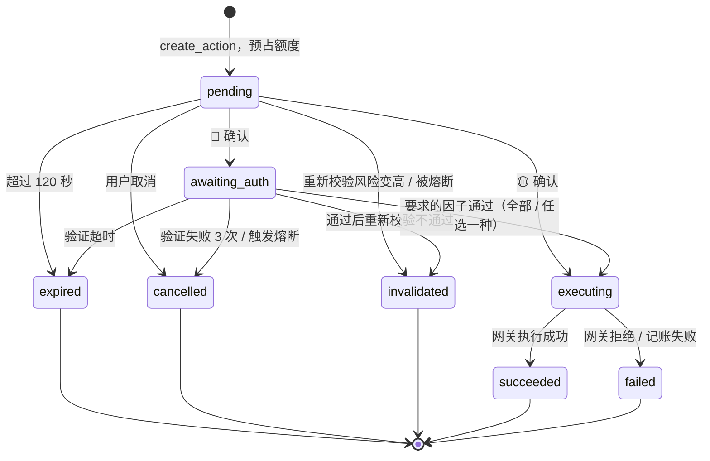
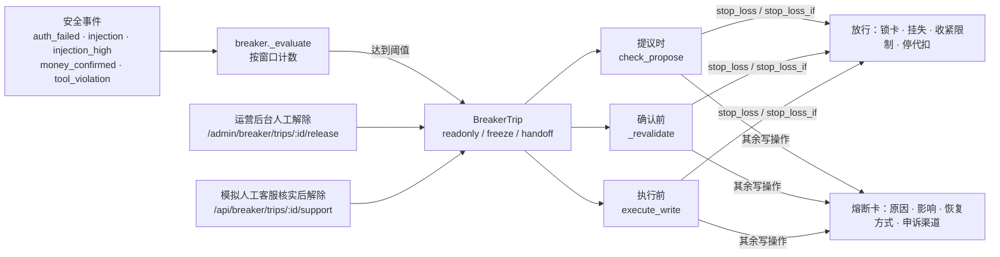
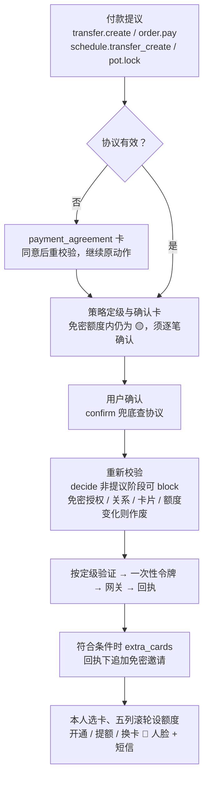
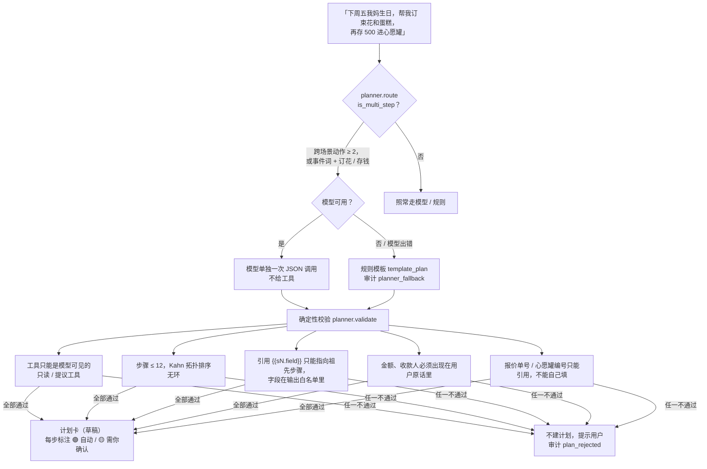
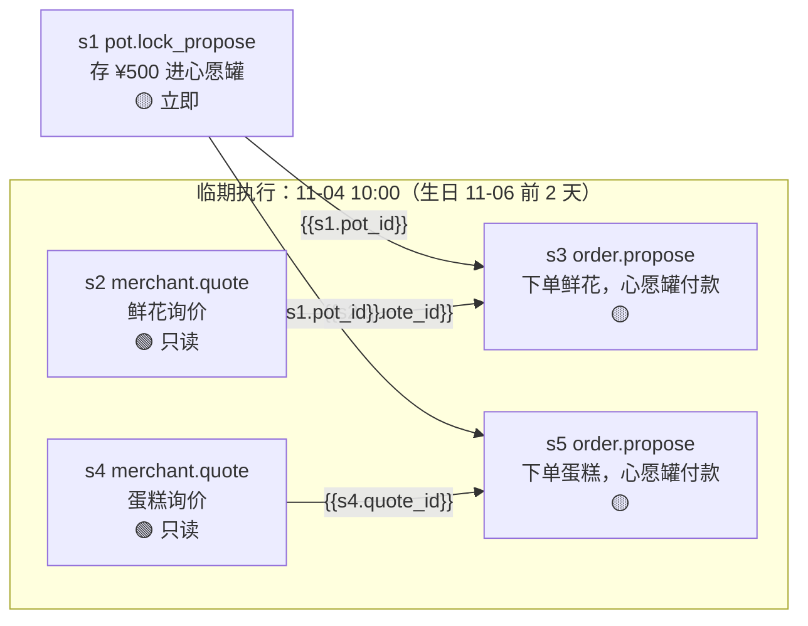
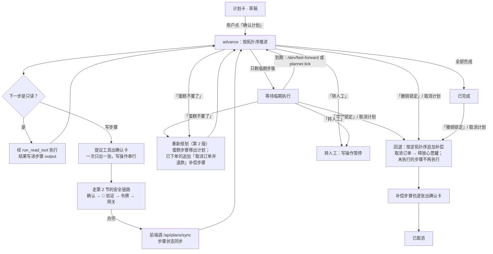
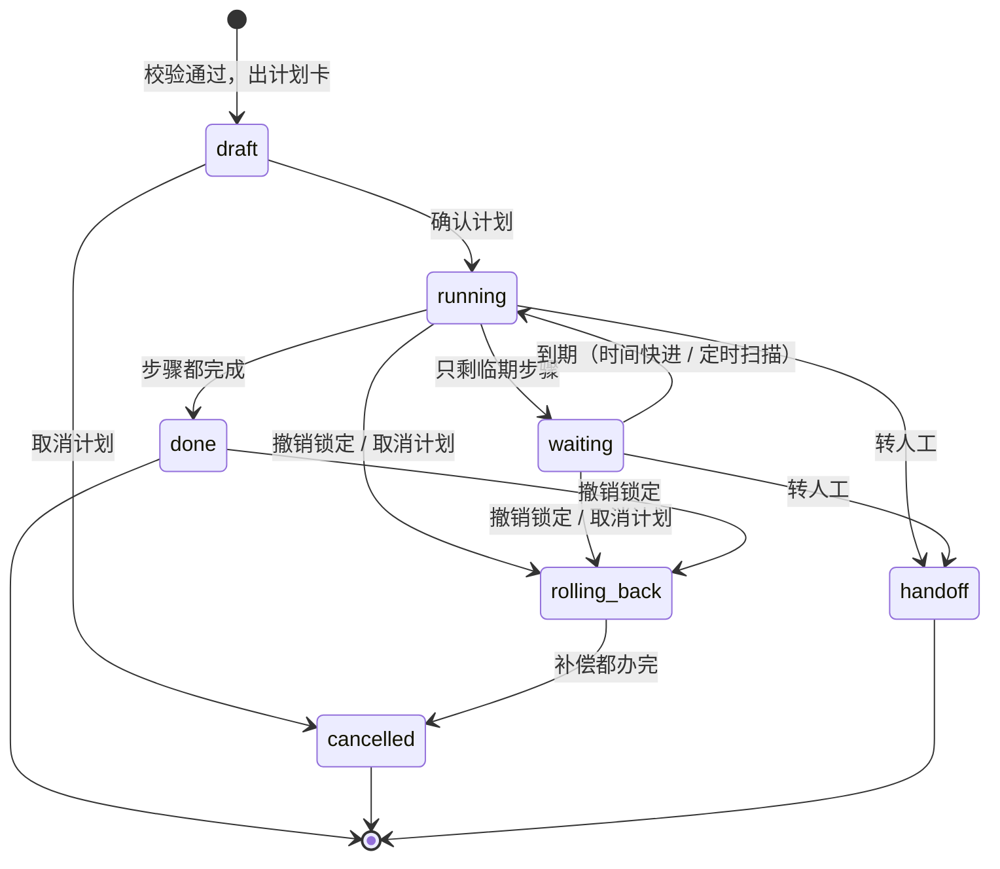

# 「言行」架构图

| 项目 | 内容 |
|---|---|
| 版本 | v2 · 2026-11-01（main `3e0c82e`，已合并免密支付） |
| 关联 | [技术文档 §2 目标架构](02-产品技术文档.md#2-总体架构) · [技术文档 §3.4 赛期落地调整](02-产品技术文档.md#34-赛期落地调整2026-10-29) · [安全自评报告](05-安全自评报告.md) |
| 说明 | 图里的代码路径相对 `apps/api/app/`。技术文档 §2 画的是目标架构（LangGraph、PostgreSQL、Redis、IM 渠道），本文画的是比赛版本**实际实现**的结构 |

> **比赛版本**：支付服务协议、免密支付授权、联系人管理和心愿罐明细已合入 main（`3e0c82e`），属于比赛提交版。支付链路见 §2.3。模拟环境只有Ⅰ类借记卡主账户（尾号 6688）有付款账本，暂不支持用绑定进来的他行卡付款。

图用 mermaid 编写，GitHub、VS Code、Typora 可以直接渲染；导出 PNG / SVG 可用 [mermaid.live](https://mermaid.live) 或 `npx @mermaid-js/mermaid-cli`。

---

## 1. 总体架构

两个平面：**认知平面**（大模型 + 确定性工作流 / 规则兜底）只负责理解、规划和组织语言，输出的动作都只是「提议」；**执行平面**（确定性代码）负责定级、确认、验证、执行和审计。模型没有任何执行凭证。

### 1.1 模块对照

| 层 | 职责 | 代码 |
|---|---|---|
| 前端 | 手机端对话页、卡片注册表、运营后台、模型设置 | `apps/web/src/App.vue`、`components/CardHost.vue`、`components/cards/`、`AuditTimeline.vue`、`RiskPanel.vue`、`ModelSettings.vue` |
| 接入层 | 用户端、运营后台（`ADMIN_PASSWORD` 口令）、演示接口 | `routes/__init__.py` |
| IM 渠道 | 企业微信智能机器人长连接（不需公网 IP）、身份绑定、渠道降权：写操作进智能体前拦下，漏网的待确认动作当场撤销，只回 App 链接 | `channels/__init__.py`、`channels/wecom.py` |
| 模型设置 | 供应商二选一、密钥写入 `.env` 并立即生效、测试连接 | `llm_setup.py`（`/admin/llm-config`） |
| 认知平面 | 一轮对话的入口和路由、模型工具循环、规则兜底、规划器、事实校验、隔离模型 | `agent/loop.py`、`agent/planner.py`、`agent/grounding.py`、`agent/quarantine.py`、`agent/prompts.py`、`nlu/` |
| 执行平面 | 工具注册与网关、策略定级、待确认动作生命周期、令牌、熔断、沙箱 | `tools/__init__.py`、`tools/gateway.py`、`policy/`、`auth/`、`security/breaker.py`、`sandbox/` |
| 领域 | 八个业务域的工具 | `tools/bank.py`（余额）、`transfer.py`、`bill.py`、`bill_analysis.py`、`card.py`、`wealth.py`、`subscription.py`、`automation.py`、`knowledge.py`（知识问答，只读） |
| 模拟核心 | 复式记账、种子数据、商户、理财产品、花店 / 蛋糕店、手机号目录 | `core_mock/` |
| 数据 | SQLite、审计哈希链、模拟时钟 | `db.py`、`models.py`、`audit/`、`clock.py` |

### 1.2 一轮对话怎么路由

**确定性工作流**：查余额、给已有收款人转账、锁卡 / 挂失 / 限额、账单报告 / 分类 / 异常 / 支出总览、交易明细、订阅总览 / 停代扣、理财测评 / 持仓 / 对比 / 申购 / 赎回、AA 这些固定流程，规则引擎能拿到全部参数时直接办理，不调模型（毫秒级，同一句话每次出的卡片都一样）。出的确认卡和模型路径一样经过策略定级、反诈扫描、强验证和网关。白名单按回归集实测定。交易明细只在规则接得住整句话时走工作流：把认出的时间、商户、分类、收款人、金额条件和查询用语去掉后什么都不剩（「近30天的消费记录」「上个月在美团花了多少」）；剩下比较、平均、规则不认识的商户、两个同名收款人这类内容的交给模型。开放问题、知识问答、一句话问几件事、多轮指代仍交给模型。`WORKFLOW_ENABLED=false`（或「设置」→「模型」的开关）可关掉做对比：同一批 12 个账单问题各问 3 遍，工作流平均 0.02 秒、数字与账务引擎一致 36 / 36、3 遍结果相同 12 / 12，全部交给模型是 9.31 秒、29 / 36、9 / 12（[测试报告 §3.4](06-测试报告.md#34-确定性工作流-vs-全部交给模型)）。

模型的消息里，用户原话的手机号、卡号先替换成占位符；工具结果里的完整账号也会脱敏后再交给模型（`loop._masked_exchange`）。

---

## 2. 写操作安全链路

所有写操作（转账、锁卡、申购、停代扣、心愿罐、下单、定时转账）共用这一条链路。模型最多走到第 4 步「生成确认卡」，后面每一步都由用户端直接调接口，**不经过模型**。

**关键点**

| 环节 | 防的是什么 | 代码 |
|---|---|---|
| 写工具对模型不可见 | 模型被注入后直接调写工具 | `tools/__init__.py`（`llm_visible=False`）；`gateway.run_read_tool` 拒绝写工具 |
| 定级在策略引擎 | 模型说「这笔是小额」 | `policy/__init__.py` 的 `evaluate`，规则只升不降 |
| digest 绑定 | 确认后改金额 / 收款人 | `auth/tokens.compute_digest`；确认、验证码、人脸断言、令牌都绑定 |
| 执行前重新校验 | 出卡后余额、额度、卡状态、测评等级、协议状态变了 | `auth/actions._revalidate`（确认时、最后一个因子通过后各一次） |
| 一次性令牌 | 重放 | `auth/tokens.py`、`gateway.execute_write` |
| 熔断两处检查 | 熔断期间仍执行 | `breaker.check_propose`、`breaker.check` |

### 2.1 待确认动作的状态

除 `succeeded` 外，所有终止状态都会释放预占的额度（`actions._release`）。

### 2.2 熔断的检查点

### 2.3 支付协议与免密授权链路

新增 `payments.py`（协议 / 资格 / 额度）、`tools/payment.py`（授权）、`tools/contact.py`（联系人），复用原确认、令牌和审计链路。`models.py` 新增 `PaymentConsent` / `payment_consents`、`PaymentMandate` / `payment_mandates`，`Contact` 新增关系验证和软删除字段，详见[技术文档 §5.10](02-产品技术文档.md#510-支付协议与免密授权)。

免密资格由服务端产生 `nopwd_ok`，只豁免三条额度规则；`args.nopwd={mandate_id, version}` 参与 digest，免验证不免确认，新收款人、频繁转账、拆单、反诈、注入不豁免。解除关系 / 删除联系人会立即取消其免密资格，改卡号按新收款人处理；重新绑定关系正常情况下 🔴 人脸或短信任选一种。心愿罐存入 / 退回 🟡，不占转出或免密额度；`pot.detail` 和 `GET /api/pots/{pot_id}/txns` 从现有账本分录读取明细。

---

## 3. 跨场景计划 DAG

### 3.1 从一句话到计划

### 3.2 生日用例的计划结构

规则模板（`planner.template_plan`）对这句话生成 5 步。实线是依赖，虚线框里的步骤在临期（事件日前 2 天 10:00）才执行：

订单定级规则 `order_strong_auth`：合作商户 + 从心愿罐付款 + 当日累计转出 ≤ 1000 元时是 🟡（一键确认），否则 🔴。

### 3.3 计划的执行、重新规划和回退

### 3.4 计划状态

步骤状态：待执行、待你确认、已完成、未完成、已取消、已移出计划（`planner.STEP_LABELS`）。

**安全边界**：确认计划只表示同意按这个顺序办，不等于确认任何一笔付款。每个写步骤都由提议工具单独出确认卡，走第 2 节的完整链路；计划步骤调用工具时也经过 `run_read_tool`，受参数白名单和断路器约束。
