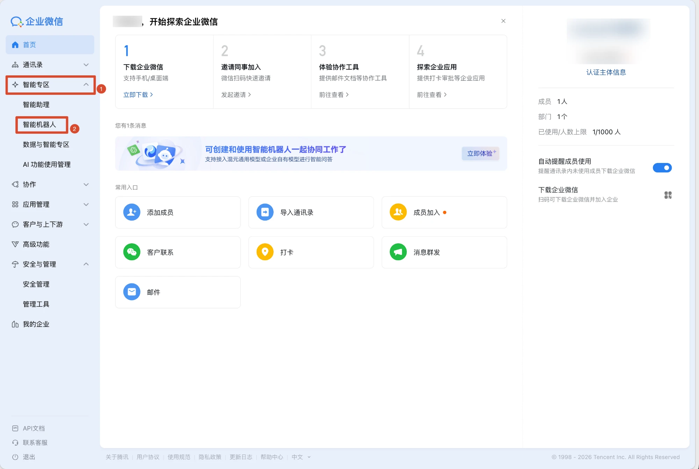
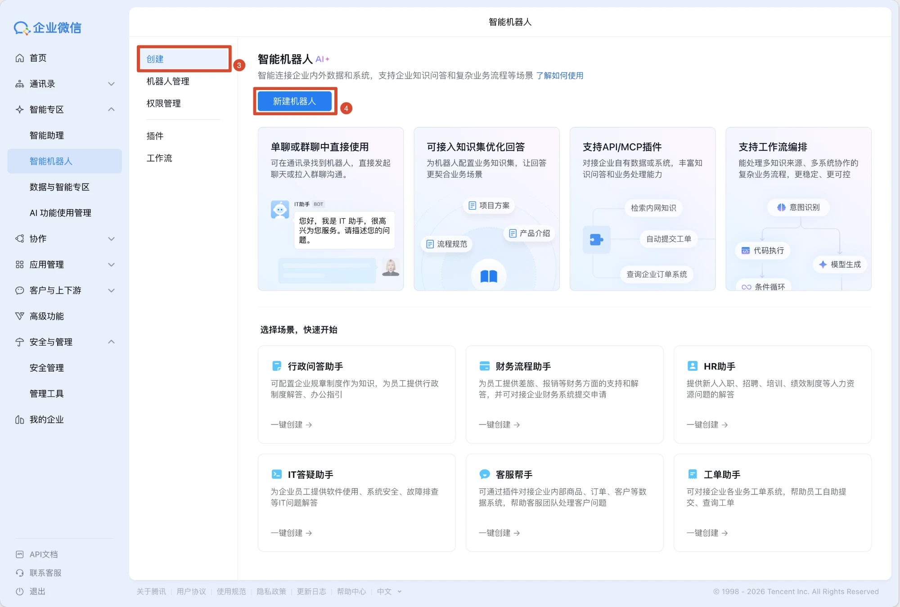
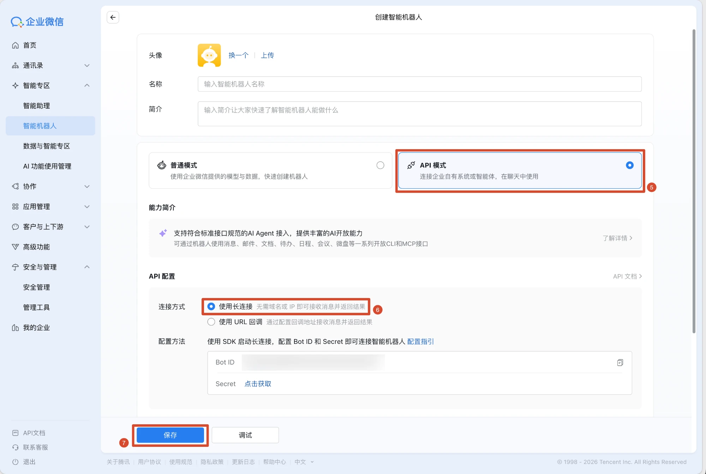

# 企业微信配置教程

| 项目 | 内容 |
|---|---|
| 用途 | 把言行接入企业微信「智能机器人」，在企业微信里私聊机器人做只读查询 |
| 用时 | 约 2 分钟；要在手机上点链接回 App 再加 3 分钟（第 6 步） |
| 前提 | 已注册企业微信（个人可以注册测试企业），有管理员账号；言行后端在本机运行 |
| 页面内教程 | 言行右上角「设置」→「企业微信」，有同样的步骤和截图，点图可放大 |

接入方式是**长连接**：后端主动连 `wss://openws.work.weixin.qq.com`，不需要公网 IP、域名和回调地址，笔记本上就能跑。

---

## 第 1 步：打开智能机器人

用管理员登录企业微信管理后台 <https://work.weixin.qq.com>，左侧点 **「智能专区」→「智能机器人」**。



> 旧版后台的入口在「安全与管理」→「管理工具」→「智能机器人」。两处都没有时，可以在企业微信客户端的「工作台」→「智能机器人」里创建，步骤相同。

## 第 2 步：新建机器人

左侧选 **「创建」**，点蓝色的 **「新建机器人」**。



不要用下方「选择场景，快速开始」里的模板，模板创建的是普通模式机器人，没有 API。

## 第 3 步：选 API 模式和长连接，取凭证



1. 填头像和名称（如「言行助手」），简介可以不填。
2. 模式选 **「API 模式」**（标 5 处）。
3. 连接方式选 **「使用长连接」**（标 6 处）。不要选「使用 URL 回调」：回调需要公网地址，而且两种方式只能二选一，切换后另一种会失效。
4. 复制 **Bot ID**；**Secret** 点「点击获取」后复制。
5. 点 **「保存」**（标 7 处）。

Secret 相当于机器人的密码，不要发到聊天、截图或提交到仓库里。

## 第 4 步：在言行里填写并连接

1. 打开言行，右上角 **「设置」→「企业微信」**。设了运营后台口令（`ADMIN_PASSWORD`）的话先输口令。
2. 粘贴 Bot ID 和 Secret，点 **「保存并连接」**。
3. 一两秒后状态变成 **「已连接」**。

| 状态 | 含义 | 怎么办 |
|---|---|---|
| 已连接 | 正常 | 去企业微信里试 |
| Bot ID 或 Secret 不对 | 企业微信拒绝了订阅 | 重新复制两项；确认第 3 步选的是「使用长连接」并已保存 |
| 连接断开，正在重连 | 网络不通，下面会显示具体原因 | 检查网络。默认直连企业微信、不走系统代理；必须走代理时在 `.env` 设 `WECOM_PROXY=http://代理地址:端口` |
| 这个机器人在别处建立了新连接 | 同一个机器人同一时间只能有一个连接，另一台电脑或另一个后端用同一套凭证连上了 | 只保留一处；要在本机恢复，在设置页重新点「保存并连接」 |

凭证保存在仓库根目录的 `.env`（`WECOM_BOT_ID`、`WECOM_BOT_SECRET`），不用重启后端。也可以直接编辑 `.env` 后重启，效果一样。

## 第 5 步：在企业微信里对话

打开企业微信客户端，在**通讯录**里搜机器人的名字，发起**单聊**。依次试：

| 你发 | 预期 |
|---|---|
| 我还有多少钱 | 余额合计和各账户（走确定性工作流，基本秒回） |
| 上个月的账单报告 | 收入、消费、储蓄率等几行要点（「上个月」总有完整一个月的数据；月初问「这个月」几乎没有流水） |
| 锁卡和挂失有什么区别 | 知识库回答 |
| 给我妈转500 | **不办理**，只回「这项操作需要在言行 App 内确认」和 App 链接 |

说明：

- **渠道降权**：企业微信里只做只读查询。转账、锁卡、申购赎回、停代扣等需要确认的操作一律引导回 App，确认卡、人脸 + 短信验证、执行令牌只在 App 里走。
- **群聊**里不查账户信息，会提示改用私聊。
- **身份绑定（演示版）**：第一次来消息的企业微信成员自动绑定到演示用户「李明」（`WECOM_BIND_USER_ID`，默认 1）。`WECOM_ALLOWED_USERS` 可以限定只有哪些 userid 能用。真实环境应改成用户在 App 内登录后经企业微信 OAuth 授权绑定。
- **手机上点 App 链接**：默认链接 `http://127.0.0.1:5173` 只有电脑自己能打开，手机上提示「无法访问网页」是正常的，按第 6 步改。
- **评测不会抢连接**：`make eval-llm`、`make smoke-llm`、知识问答评测和自动化测试都不连企业微信，可以在演示后端运行时放心跑。

## 第 6 步：手机上点链接回 App

「给我妈转500」回的链接要能在手机上打开，需要手机能访问电脑上的言行前端。

1. **手机开热点，电脑连上这个热点。** 校园网、公司 Wi-Fi 一般会隔离设备，手机访问不到电脑；家里的 Wi-Fi 通常可以，两边连同一个也行。
2. **照常启动。** 在仓库根目录运行：

   ```bash
   make dev
   ```

   前端默认监听 `0.0.0.0:5173`，同一网络里的设备都能访问，启动日志里 `Network:` 那行就是手机要打开的地址。后端只监听本机，手机的请求经前端代理转过去。
3. **核对链接。** 「App 地址」保持默认的 `http://127.0.0.1:5173` 就行：发链接时会自动换成电脑当前的局域网地址，换网络也跟着变。电脑浏览器打开言行 →「设置」→「企业微信」，「企业微信里发出的链接」应显示 `http://172.20.10.x:5173`（iPhone 热点）或 `http://192.168.x.x:5173`；还是 127.0.0.1 说明电脑没连上局域网。
4. **试一下。** 在企业微信里发「给我妈转500」，点回复里的链接，手机浏览器打开言行，输入框里已经填好「给我妈转500」，核对后点发送，在 App 里走确认卡和验证。

链接里只带一个随机的交接码（形如 `?r=Xy3_k9Qa`），不带原话：原话存在后端，30 分钟内有效，只有同一个绑定用户能取出；过期或换了用户就提示重新说一遍。预填之后**不会自动发送**，要用户自己点发送。

| 现象 | 原因 | 怎么办 |
|---|---|---|
| 手机上仍提示无法访问 | 两边不在同一网络，或网络隔离设备；或者 macOS 防火墙拦了 node | 改用手机热点；第一次启动时 macOS 问「是否允许 node 接受传入网络连接」选允许（「系统设置」→「网络」→「防火墙」里也能改） |
| 链接还是 127.0.0.1 | 电脑没连任何局域网，或「App 地址」被改成了别的固定地址 | 连上热点；「App 地址」改回 `http://127.0.0.1:5173` |
| 手机打开的是旧链接 | 换网络之前发的链接，地址已经变了 | 换网络后在企业微信里重新发一次 |
| 打开后输入框是空的，提示链接已过期 | 超过 30 分钟，或换了用户 | 在 App 里重新说一下要办理什么 |
| macOS 弹窗问是否允许 node 接受传入连接 | 系统防火墙 | 点「允许」 |
